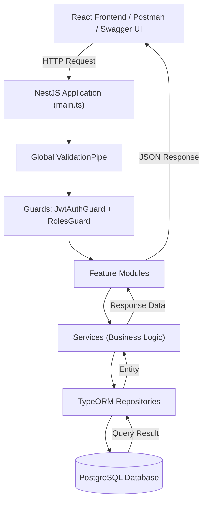
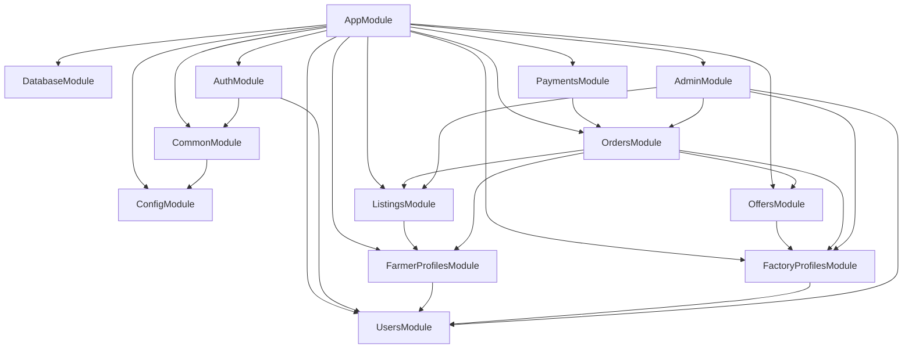
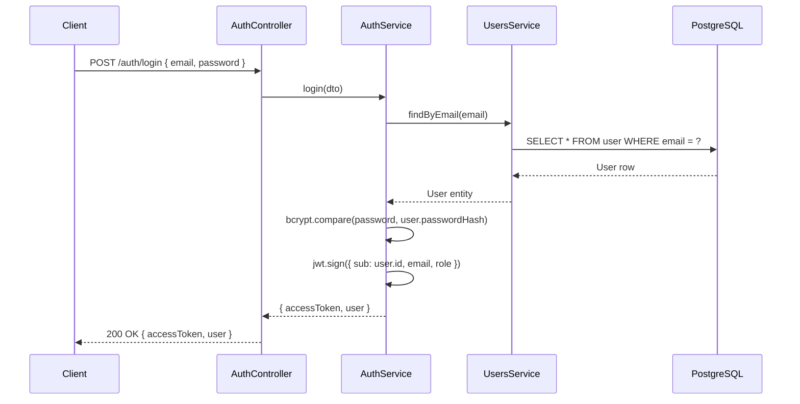
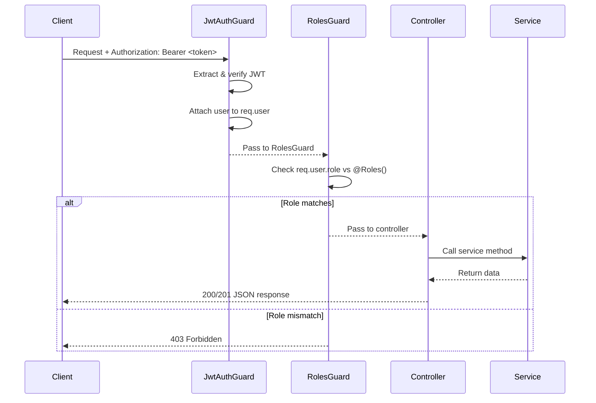
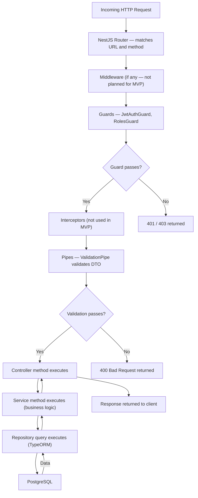

# ChaBondhu — Backend Architecture

**Version:** 1.0  
**Date:** 2026-11-05  
**Framework:** NestJS  
**Language:** TypeScript  
**Database:** PostgreSQL + TypeORM  

---

## Table of Contents

1. [Overview](#1-overview)
2. [High-Level Architecture](#2-high-level-architecture)
3. [NestJS Module Structure](#3-nestjs-module-structure)
4. [Module Dependency Graph](#4-module-dependency-graph)
5. [Folder and File Structure](#5-folder-and-file-structure)
6. [Authentication and Authorization Architecture](#6-authentication-and-authorization-architecture)
7. [Request Lifecycle](#7-request-lifecycle)
8. [Database Access Pattern](#8-database-access-pattern)
9. [Business Logic Rules — Summary](#9-business-logic-rules--summary)
10. [Environment Configuration](#10-environment-configuration)
11. [Swagger API Documentation](#11-swagger-api-documentation)
12. [Module Responsibility Map](#12-module-responsibility-map)
13. [Implementation Order (Phase 1 Plan)](#13-implementation-order-phase-1-plan)

---

## 1. Overview

ChaBondhu's backend is a **modular RESTful API** built with NestJS and TypeScript. The backend serves as the data and business logic layer for the platform. The React frontend (Phase 2) will consume this API.

### 1.1 Core Design Decisions

| Decision | Choice | Reason |
|---|---|---|
| Framework | NestJS | Course requirement; opinionated, modular, TypeScript-native |
| Database | PostgreSQL | Course requirement; reliable relational database |
| ORM | TypeORM | Course requirement; integrates cleanly with NestJS |
| Auth | JWT + Passport | Course requirement; stateless, standard for REST APIs |
| Validation | `class-validator` + `ValidationPipe` | Course requirement; declarative, integrated with NestJS |
| Password hashing | bcrypt | Industry standard for password security |
| API documentation | Swagger (via `@nestjs/swagger`) | Built-in; useful for Postman testing and grading |

### 1.2 What the Backend Is Responsible For

- Handling all HTTP requests from the frontend (or Swagger/Postman)
- Validating all incoming data through DTOs
- Authenticating users via JWT
- Enforcing role-based access control
- Executing business logic (order state machine, price preservation, etc.)
- Persisting and retrieving data via TypeORM and PostgreSQL
- Returning structured JSON responses with correct HTTP status codes

---

## 2. High-Level Architecture



---

## 3. NestJS Module Structure

ChaBondhu uses **one NestJS module per domain feature**. Each module is self-contained and follows the same internal structure.

### 3.1 Module List

| Module | Responsibility | NestJS Class |
|---|---|---|
| `AppModule` | Root module; imports all feature modules | `AppModule` |
| `ConfigModule` | Loads `.env` via `@nestjs/config` | — |
| `DatabaseModule` | Configures TypeORM connection | — |
| `AuthModule` | Registration, login, JWT issuance, Passport strategy | `AuthModule` |
| `UsersModule` | User profile management (`/users`) | `UsersModule` |
| `FarmerProfilesModule` | Farmer profile CRUD (`/farmer-profiles`) | `FarmerProfilesModule` |
| `ListingsModule` | Harvest listing CRUD and status (`/listings`) | `ListingsModule` |
| `FactoryProfilesModule` | Factory profile CRUD (`/factory-profiles`) | `FactoryProfilesModule` |
| `OffersModule` | Price offer management (`/offers`) | `OffersModule` |
| `OrdersModule` | Factory requests, grower decisions, confirmed orders, and pickup | `OrdersModule` |
| `PaymentsModule` | Payment record management (`/payments`) | `PaymentsModule` |
| `AdminModule` | Admin endpoints (`/admin`) | `AdminModule` |
| `CommonModule` | Shared guards, decorators, utilities | — |

### 3.2 Standard Module Internal Structure

Each feature module follows this four-layer pattern:

```
feature/
  feature.module.ts       ← Module: wires everything together
  feature.controller.ts   ← Controller: handles HTTP routes
  feature.service.ts      ← Service: business logic
  feature.entity.ts       ← Entity: TypeORM database table definition
  dto/
    create-feature.dto.ts ← DTO: request body for POST
    update-feature.dto.ts ← DTO: request body for PATCH
```

---

## 4. Module Dependency Graph



> **Important NestJS rule:** Services can only be injected if their module is imported. If `OrdersModule` needs `ListingsService`, it must import `ListingsModule` and `ListingsModule` must export `ListingsService`.

---

## 5. Folder and File Structure

```
ChaBondhu/
  backend/
    src/
      main.ts                     ← Application entry point; Swagger setup; global pipes
      app.module.ts               ← Root module; imports all feature modules

      config/
        database.config.ts        ← TypeORM DataSource configuration from env vars
        jwt.config.ts             ← JWT module configuration

      common/
        guards/
          jwt-auth.guard.ts       ← Checks for valid JWT
          roles.guard.ts          ← Checks user role against @Roles() decorator
        decorators/
          roles.decorator.ts      ← @Roles(UserRole.GROWER) custom decorator
          current-user.decorator.ts ← @CurrentUser() extracts user from req
        enums/
          user-role.enum.ts       ← UserRole enum: GROWER, FACTORY, ADMIN
          order-status.enum.ts    ← OrderStatus enum
          payment-status.enum.ts  ← PaymentStatus enum
          listing-status.enum.ts  ← ListingStatus enum
          offer-status.enum.ts    ← OfferStatus enum

      auth/
        auth.module.ts
        auth.controller.ts        ← POST /auth/register, POST /auth/login
        auth.service.ts           ← register(), login(), validateUser()
        strategies/
          jwt.strategy.ts         ← PassportStrategy(Strategy) using 'jwt'
        dto/
          register.dto.ts
          login.dto.ts
        interfaces/
          jwt-payload.interface.ts ← { sub, email, role }

      users/
        users.module.ts
        users.controller.ts       ← GET /users/me, PATCH /users/me
        users.service.ts          ← findById(), findByEmail(), update()
        user.entity.ts            ← @Entity() User
        dto/
          update-user.dto.ts

      farmer-profiles/
        farmer-profiles.module.ts
        farmer-profiles.controller.ts
        farmer-profiles.service.ts
        farmer-profile.entity.ts
        dto/
          create-farmer-profile.dto.ts
          update-farmer-profile.dto.ts

      listings/
        listings.module.ts
        listings.controller.ts
        listings.service.ts
        harvest-listing.entity.ts
        dto/
          create-listing.dto.ts
          update-listing.dto.ts

      factory-profiles/
        factory-profiles.module.ts
        factory-profiles.controller.ts
        factory-profiles.service.ts
        factory-profile.entity.ts
        dto/
          create-factory-profile.dto.ts
          update-factory-profile.dto.ts

      offers/
        offers.module.ts
        offers.controller.ts
        offers.service.ts
        price-offer.entity.ts
        dto/
          create-offer.dto.ts
          update-offer.dto.ts

      orders/
        orders.module.ts
        orders.controller.ts
        orders.service.ts         ← Contains order state machine logic
        order.entity.ts
        dto/
          create-order.dto.ts
          update-order-status.dto.ts
          update-payment-status.dto.ts

      payments/
        payments.module.ts
        payments.controller.ts
        payments.service.ts
        payment.entity.ts

      admin/
        admin.module.ts
        admin.controller.ts
        admin.service.ts

    .env                          ← Local secrets (never committed)
    .env.example                  ← Template (safe to commit)
    .gitignore
    nest-cli.json
    package.json
    tsconfig.json
    tsconfig.build.json

  docs/                           ← Project documentation
    course-syllabus.md
    project-requirements.md
    database-design.md
    api-design.md
    architecture.md               ← This file

  AGENTS.md                       ← Permanent project rules
```

---

## 6. Authentication and Authorization Architecture

### 6.1 Overview



### 6.2 Protected Request Flow



### 6.3 Guard Architecture

```
JwtAuthGuard           → Verifies JWT; populates req.user
  └── JwtStrategy      → Extracts payload; loads user from DB
  
RolesGuard             → Reads @Roles() decorator; compares with req.user.role
  └── Roles decorator  → @Roles(UserRole.GROWER, UserRole.FACTORY)
```

**Usage in controllers:**

```typescript
// Requires any valid JWT:
@UseGuards(JwtAuthGuard)

// Requires JWT AND a specific role:
@UseGuards(JwtAuthGuard, RolesGuard)
@Roles(UserRole.GROWER)

// Requires JWT AND admin role:
@UseGuards(JwtAuthGuard, RolesGuard)
@Roles(UserRole.ADMIN)
```

### 6.4 JWT Payload Structure

```typescript
interface JwtPayload {
  sub: number;        // user.id
  email: string;
  role: UserRole;
}
```

### 6.5 CurrentUser Decorator

A custom `@CurrentUser()` decorator extracts `req.user` and injects it directly into controller methods:

```typescript
@Get('me')
@UseGuards(JwtAuthGuard)
getProfile(@CurrentUser() user: User) {
  return this.usersService.findById(user.id);
}
```

---

## 7. Request Lifecycle

The lifecycle of every HTTP request through the NestJS application:



---

## 8. Database Access Pattern

### 8.1 Repository Pattern via TypeORM

NestJS + TypeORM uses the **Repository Pattern**. Each entity has a repository injected into its service:

```typescript
@Injectable()
export class ListingsService {
  constructor(
    @InjectRepository(HarvestListing)
    private readonly listingRepository: Repository<HarvestListing>,
  ) {}

  async findAll(): Promise<HarvestListing[]> {
    return this.listingRepository.find({
      where: { status: ListingStatus.ACTIVE, isActive: true },
      relations: ['farmerProfile'],
    });
  }
}
```

### 8.2 Entity Registration

Each entity must be registered in its module using `TypeOrmModule.forFeature()`:

```typescript
@Module({
  imports: [TypeOrmModule.forFeature([HarvestListing])],
  controllers: [ListingsController],
  providers: [ListingsService],
  exports: [ListingsService],
})
export class ListingsModule {}
```

### 8.3 TypeORM Configuration

The global TypeORM connection is configured in `AppModule` using `TypeOrmModule.forRootAsync()`, reading all connection parameters from environment variables via `ConfigService`. No hard-coded values.

```
DB_HOST=localhost
DB_PORT=5432
DB_USERNAME=chabondhu_user
DB_PASSWORD=your_password_here
DB_NAME=chabondhu_db
```

> **`synchronize: true`** is used only during development to auto-update the schema. Before final submission, this will be switched to `false` and migrations will be used instead.

---

## 9. Business Logic Rules — Summary

All business logic lives in **service classes**. Controllers never contain conditional logic.

| Rule | Service | Method |
|---|---|---|
| Hash password before saving | `AuthService` | `register()` |
| Snapshot the offer price on submission and copy the request quote on acceptance | `OrderRequestsService` | `submit()`, `accept()` |
| Validate order status transitions | `OrdersService` | `updateOrderStatus()` |
| Validate payment status transitions | `OrdersService` | `updatePaymentStatus()` |
| Check listing belongs to requesting farmer | `ListingsService` | `create()`, `update()`, `cancel()` |
| Check offer belongs to requesting factory | `OffersService` | `update()`, `withdraw()` |
| Check factory is verified before creating offer | `OffersService` | `create()` |
| Prevent cancellation of listing with active orders | `ListingsService` | `cancel()` |
| Auto-mark listing as `SOLD` when order completes | `OrdersService` | `completeOrder()` |
| Calculate `totalAmountBdt` using decimal precision | `PaymentsService` | `createPaymentRecord()` |
| Check listing is `ACTIVE` before allowing order | `OrdersService` | `createOrder()` |
| Check offer is `ACTIVE` and not expired before allowing order | `OrdersService` | `createOrder()` |
| Prevent deactivated users from logging in | `AuthService` | `validateUser()` |

### 9.1 Order Status Transition Table (Enforced in Service)

```typescript
const VALID_ORDER_TRANSITIONS: Record<OrderStatus, OrderStatus[]> = {
  [OrderStatus.ACCEPTED]:         [OrderStatus.PICKUP_SCHEDULED, OrderStatus.CANCELLED],
  [OrderStatus.PICKUP_SCHEDULED]: [OrderStatus.COLLECTED],
  [OrderStatus.COLLECTED]:        [OrderStatus.COMPLETED],
  [OrderStatus.COMPLETED]:        [],   // Terminal
  [OrderStatus.CANCELLED]:        [],   // Terminal
};
```

Requests have their own statuses. A grower can accept or reject a pending request, and its factory can withdraw it. Acceptance locks the listing first, creates an order, sets the listing to `RESERVED`, and closes competing requests in one transaction. Phase 7 implements transitions through collection. Completion follows confirmed payment in a later phase.

### 9.2 Payment Status Transition Table (Enforced in Service)

```typescript
const VALID_PAYMENT_TRANSITIONS: Record<PaymentStatus, PaymentStatus[]> = {
  [PaymentStatus.PENDING]:    [PaymentStatus.PROCESSING, PaymentStatus.FAILED],
  [PaymentStatus.PROCESSING]: [PaymentStatus.COMPLETED, PaymentStatus.FAILED],
  [PaymentStatus.COMPLETED]:  [],   // Terminal
  [PaymentStatus.FAILED]:     [],   // Terminal
};
```

---

## 10. Environment Configuration

All secrets and environment-specific configuration live in a `.env` file at the root of the `backend/` directory. This file is **never committed to version control**.

A `.env.example` file (safe to commit) documents every required variable without values.

### 10.1 Required Environment Variables

```bash
# Application
NODE_ENV=development
PORT=3000

# Database (PostgreSQL)
DB_HOST=localhost
DB_PORT=5432
DB_USERNAME=chabondhu_user
DB_PASSWORD=your_secure_password_here
DB_NAME=chabondhu_db

# JWT
JWT_SECRET=your_jwt_secret_key_here_make_it_long_and_random
JWT_EXPIRES_IN=7d

# bcrypt
BCRYPT_SALT_ROUNDS=10
```

### 10.2 Accessing Config in NestJS

Configuration is accessed through NestJS's `ConfigService` (from `@nestjs/config`), not through direct `process.env` calls:

```typescript
constructor(private configService: ConfigService) {}

const secret = this.configService.get<string>('JWT_SECRET');
```

---

## 11. Swagger API Documentation

Swagger UI is set up in `main.ts` using `@nestjs/swagger`. It is accessible at:

```
http://localhost:3000/api/docs
```

All controllers and DTOs are annotated with Swagger decorators:
- `@ApiTags('listings')` on controllers
- `@ApiOperation({ summary: '...' })` on methods
- `@ApiProperty()` on DTO fields
- `@ApiBearerAuth()` on protected controllers

This serves as the primary tool for testing the API during development, alongside Postman.

---

## 12. Module Responsibility Map

| Module | Entity | Controller Routes | Service Responsibilities |
|---|---|---|---|
| `AuthModule` | — | `POST /auth/register`, `POST /auth/login` | Hash password, validate user, sign JWT |
| `UsersModule` | `User` | `GET /users/me`, `PATCH /users/me` | Find user, update safe fields |
| `FarmerProfilesModule` | `FarmerProfile` | `POST`, `GET /me`, `GET /:id`, `PATCH /me` | CRUD; enforce one-per-user |
| `ListingsModule` | `HarvestListing` | `POST`, `GET /`, `GET /my`, `GET /:id`, `PATCH /:id`, `PATCH /:id/cancel`, `DELETE /:id` | CRUD; ownership check; cancellation guard |
| `FactoryProfilesModule` | `FactoryProfile` | `POST`, `GET /me`, `GET /:id`, `PATCH /me` | CRUD; enforce one-per-user |
| `OffersModule` | `PriceOffer` | `POST /offers`, `GET /offers`, `GET /offers/my`, `GET /offers/:id`, `PATCH /offers/:id`, `PATCH /offers/:id/withdraw` | Publishing and editing check factory verification. Owner writes lock the offer before checking its state. Public reads apply the expiry cutoff, and an in-process job persists expiry at startup and every minute. |
| `OrdersModule` | `OrderRequest`, `Order` | `/order-requests`, `/listings/:id/order-requests`, `/orders/my`, `/orders/:id`, `/orders/:id/status` | Verifies ownership and eligibility, reserves listings atomically, and handles cancellation, pickup, and collection |
| `PaymentsModule` | `Payment` | `GET /order/:orderId` | Retrieve payment record; calculate total |
| `AdminModule` | — | `/admin/users/*`, `/admin/listings`, `/admin/orders` | Cross-module admin queries; verification; deactivation |
| `CommonModule` | — | — | Guards, decorators, shared enums |

---

## 13. Implementation Order (Phase 1 Plan)

Modules will be implemented one at a time, in this order. Each module must be complete (entity, service, controller, DTOs, and working API test) before the next begins.

| Step | Module | Prerequisite |
|---|---|---|
| 1 | NestJS project scaffold + AppModule + Swagger setup | None |
| 2 | Database connection (`TypeOrmModule.forRootAsync`) | .env file, PostgreSQL running |
| 3 | `CommonModule` — enums, guards, decorators | None |
| 4 | `UsersModule` — entity + service (no controller yet; needed by Auth) | Database |
| 5 | `AuthModule` — register, login, JWT, Passport strategy | UsersModule |
| 6 | `UsersModule` controller — `GET /users/me`, `PATCH /users/me` | AuthModule |
| 7 | `FarmerProfilesModule` | AuthModule, UsersModule |
| 8 | `FactoryProfilesModule` | AuthModule, UsersModule |
| 9 | `ListingsModule` | FarmerProfilesModule |
| 10 | `OffersModule` | FactoryProfilesModule |
| 11 | `OrdersModule` | ListingsModule, OffersModule, FarmerProfilesModule, FactoryProfilesModule |
| 12 | `PaymentsModule` | OrdersModule |
| 13 | `AdminModule` | UsersModule, ListingsModule, OrdersModule, FactoryProfilesModule |

> After each step: test via Swagger UI or Postman, run any relevant Jest tests, and verify the API behaves correctly before moving to the next step.

---

*Document version: 1.0*  
*Created: 2026-11-05*  
*Update this document when the architecture changes or a new module is added.*
