# ChaBondhu — Database Design

**Version:** 1.0  
**Date:** 2026-11-05  
**Database:** PostgreSQL  
**ORM:** TypeORM  
**Currency:** All monetary values are in Bangladeshi Taka (BDT)

---

## Table of Contents

1. [Design Principles](#1-design-principles)
2. [Entity: User](#2-entity-user)
3. [Entity: FarmerProfile](#3-entity-farmerprofile)
4. [Entity: FactoryProfile](#4-entity-factoryprofile)
5. [Entity: HarvestListing](#5-entity-harvestlisting)
6. [Entity: PriceOffer](#6-entity-priceoffer)
7. [Entity: Order](#7-entity-order)
8. [Entity: PickupBatch](#8-entity-pickupbatch)
9. [Entity: Payment](#9-entity-payment)
10. [Entity Relationship Summary](#10-entity-relationship-summary)
11. [ER Diagram](#11-er-diagram)
12. [Index Strategy](#12-index-strategy)
13. [Business Rule Enforcement Summary](#13-business-rule-enforcement-summary)

---

## 1. Design Principles

### 1.1 Core Rules

| Rule | Implementation |
|---|---|
| No floating-point for money | Use `NUMERIC(12, 2)` for all monetary and quantity columns |
| Agreed price is immutable | `agreedPricePerKg` is copied to `Order` at creation; never recalculated |
| Estimated quantity ≠ actual weight | `estimatedQuantityKg` on `HarvestListing`; `actualCollectedWeightKg` on `Order` |
| Order status ≠ payment status | Two independent enum columns on `Order`; managed by separate service methods |
| Soft delete preferred | `isActive` flag on `User` and `HarvestListing`; never hard-delete rows with order history |
| Referential integrity | All foreign keys enforced at the database level |
| Timestamps on all entities | Every table has `createdAt` and `updatedAt` columns |

### 1.2 Naming Conventions

- Table names: `snake_case` (auto-generated by TypeORM from entity class names)
- Column names: `camelCase` in TypeScript entities; TypeORM maps them to `snake_case` in PostgreSQL
- Primary keys: integer auto-increment (`SERIAL` / `BIGSERIAL`) — simple and sufficient for a university MVP
- Enum types: defined as TypeScript `enum`, stored as `varchar` in PostgreSQL

### 1.3 Decimal Precision

| Column Type | Precision | Use Case |
|---|---|---|
| `NUMERIC(12, 2)` | Up to 9,999,999,999.99 | Prices, costs, totals in BDT |
| `NUMERIC(10, 3)` | Up to 9,999,999.999 | Weights in kg (3 decimal places for accuracy) |
| `NUMERIC(8, 2)` | Up to 999,999.99 | Farm size in acres |

---

## 2. Entity: User

**Table name:** `user`  
**Purpose:** Stores all platform accounts — farmers, factory representatives, and admins.

### 2.1 Columns

| Column | TypeScript Type | PostgreSQL Type | Nullable | Default | Description |
|---|---|---|---|---|---|
| `id` | `number` | `SERIAL` PK | No | auto | Primary key |
| `fullName` | `string` | `VARCHAR(150)` | No | — | User's full name |
| `email` | `string` | `VARCHAR(255)` | No | — | Unique login identifier |
| `passwordHash` | `string` | `VARCHAR(255)` | No | — | bcrypt-hashed password; never plain text |
| `phoneNumber` | `string` | `VARCHAR(20)` | No | — | Contact number |
| `role` | `UserRole` | `VARCHAR(20)` | No | — | Enum: `GROWER`, `FACTORY`, `ADMIN` |
| `isActive` | `boolean` | `BOOLEAN` | No | `true` | Soft-delete / deactivation flag |
| `createdAt` | `Date` | `TIMESTAMPTZ` | No | `now()` | Auto-set on insert |
| `updatedAt` | `Date` | `TIMESTAMPTZ` | No | `now()` | Auto-set on update |

### 2.2 Enum: UserRole

```typescript
enum UserRole {
  GROWER  = 'GROWER',
  FACTORY = 'FACTORY',
  ADMIN   = 'ADMIN',
}
```

### 2.3 Constraints

| Constraint | Column | Rule |
|---|---|---|
| PRIMARY KEY | `id` | Unique, not null, auto-increment |
| UNIQUE | `email` | No two users share an email |
| NOT NULL | `fullName`, `email`, `passwordHash`, `phoneNumber`, `role` | Required fields |
| CHECK | `role` | Must be one of the enum values |

### 2.4 Relationships

| Relationship | With Entity | Cardinality | FK Location |
|---|---|---|---|
| Has one (optional) | `FarmerProfile` | 1 : 0..1 | `farmer_profile.userId` |
| Has one (optional) | `FactoryProfile` | 1 : 0..1 | `factory_profile.userId` |

### 2.5 Indexes

| Index | Column | Reason |
|---|---|---|
| PRIMARY | `id` | Auto-created |
| UNIQUE | `email` | Login lookup |
| INDEX | `role` | Filter users by role in admin views |
| INDEX | `isActive` | Filter out deactivated accounts efficiently |

### 2.6 Business Notes

- Email is immutable after registration.
- Password is never stored in plain text.
- Setting `isActive = false` effectively deactivates the account without deleting it.
- An `ADMIN` user does not have a `FarmerProfile` or `FactoryProfile`.

---

## 3. Entity: FarmerProfile

**Table name:** `farmer_profile`  
**Purpose:** Stores the farm/garden profile of a GROWER user. One farmer = one farm profile in MVP.

### 3.1 Columns

| Column | TypeScript Type | PostgreSQL Type | Nullable | Default | Description |
|---|---|---|---|---|---|
| `id` | `number` | `SERIAL` PK | No | auto | Primary key |
| `userId` | `number` | `INTEGER` FK | No | — | References `user.id`; unique |
| `gardenName` | `string` | `VARCHAR(200)` | No | — | Name of the tea garden / farm |
| `division` | `string` | `VARCHAR(100)` | No | — | Administrative division (e.g. Rangpur) |
| `district` | `string` | `VARCHAR(100)` | No | — | District (e.g. Panchagarh) |
| `upazila` | `string` | `VARCHAR(100)` | No | — | Sub-district / Thana |
| `village` | `string` | `VARCHAR(150)` | Yes | `NULL` | Optional village or area name |
| `farmSizeAcres` | `number` | `NUMERIC(8, 2)` | Yes | `NULL` | Farm size in acres (informational only) |
| `description` | `string` | `TEXT` | Yes | `NULL` | Optional free-text description |
| `createdAt` | `Date` | `TIMESTAMPTZ` | No | `now()` | — |
| `updatedAt` | `Date` | `TIMESTAMPTZ` | No | `now()` | — |

### 3.2 Constraints

| Constraint | Column | Rule |
|---|---|---|
| PRIMARY KEY | `id` | — |
| UNIQUE | `userId` | One farmer profile per user account |
| FOREIGN KEY | `userId` → `user.id` | Must reference a valid `User` |
| NOT NULL | `userId`, `gardenName`, `division`, `district`, `upazila` | Required fields |

### 3.3 Relationships

| Relationship | With Entity | Cardinality | FK Location |
|---|---|---|---|
| Belongs to | `User` | 1 : 1 | `farmer_profile.userId` |
| Has many | `HarvestListing` | 1 : N | `harvest_listing.farmerProfileId` |

### 3.4 Indexes

| Index | Column | Reason |
|---|---|---|
| PRIMARY | `id` | — |
| UNIQUE | `userId` | Enforce one-profile-per-user |
| INDEX | `district` | Location-based filtering in future enhancements |

### 3.5 Business Notes

- `farmSizeAcres` is stored for display only. It must never be used to automatically calculate harvest quantity.
- A farmer cannot have more than one `FarmerProfile` (enforced by UNIQUE on `userId`).

---

## 4. Entity: FactoryProfile

**Table name:** `factory_profile`  
**Purpose:** Stores the factory profile of a FACTORY user.

### 4.1 Columns

| Column | TypeScript Type | PostgreSQL Type | Nullable | Default | Description |
|---|---|---|---|---|---|
| `id` | `number` | `SERIAL` PK | No | auto | Primary key |
| `userId` | `number` | `INTEGER` FK | No | — | References `user.id`; unique |
| `factoryName` | `string` | `VARCHAR(200)` | No | — | Official factory name |
| `representativeName` | `string` | `VARCHAR(150)` | No | — | Contact person name |
| `district` | `string` | `VARCHAR(100)` | No | — | Factory district |
| `upazila` | `string` | `VARCHAR(100)` | No | — | Factory sub-district |
| `address` | `string` | `TEXT` | Yes | `NULL` | Optional full address |
| `verificationStatus` | `FactoryVerificationStatus` | `VARCHAR(20)` | No | `PENDING` | `PENDING`, `VERIFIED`, or `REJECTED` |
| `verifiedAt` | `Date` | `TIMESTAMPTZ` | Yes | `NULL` | Timestamp when verified |
| `verifiedByAdminId` | `number` | `INTEGER` FK | Yes | `NULL` | References `user.id` of verifying admin |
| `createdAt` | `Date` | `TIMESTAMPTZ` | No | `now()` | — |
| `updatedAt` | `Date` | `TIMESTAMPTZ` | No | `now()` | — |

### 4.2 Constraints

| Constraint | Column | Rule |
|---|---|---|
| PRIMARY KEY | `id` | — |
| UNIQUE | `userId` | One factory profile per user account |
| FOREIGN KEY | `userId` → `user.id` | Must reference a valid `User` |
| FOREIGN KEY | `verifiedByAdminId` → `user.id` | Must reference a valid `User` with ADMIN role |
| NOT NULL | `userId`, `factoryName`, `representativeName`, `district`, `upazila` | Required fields |

### 4.3 Relationships

| Relationship | With Entity | Cardinality | FK Location |
|---|---|---|---|
| Belongs to | `User` | 1 : 1 | `factory_profile.userId` |
| Has many | `PriceOffer` | 1 : N | `price_offer.factoryProfileId` |
| Verified by (optional) | `User` (Admin) | N : 1 | `factory_profile.verifiedByAdminId` |

### 4.4 Indexes

| Index | Column | Reason |
|---|---|---|
| PRIMARY | `id` | — |
| UNIQUE | `userId` | Enforce one-profile-per-user |
| INDEX | `isVerified` | Filter verified factories quickly |

### 4.5 Business Notes

- Only `VERIFIED` factories may publish offers. API responses derive `isVerified` from `verificationStatus` for compatibility.
- Approval sets `verifiedAt` and `verifiedByAdminId`. Each decision also adds a row to `factory_verification_reviews` in the same transaction.
- Each review links to the factory profile and reviewer and stores the decision, timestamp, and required rejection reason. A rejected factory can resubmit for another review with its previous decisions retained.

---

## 5. Entity: HarvestListing

**Table name:** `harvest_listing`  
**Purpose:** A farmer's listing of available tea leaves for sale.

### 5.1 Columns

| Column | TypeScript Type | PostgreSQL Type | Nullable | Default | Description |
|---|---|---|---|---|---|
| `id` | `number` | `SERIAL` PK | No | auto | Primary key |
| `farmerProfileId` | `number` | `INTEGER` FK | No | — | References `farmer_profile.id` |
| `teaGrade` | `string` | `VARCHAR(100)` | No | — | Free-text tea grade (e.g. "Green", "CTC") |
| `estimatedQuantityKg` | `number` | `NUMERIC(10, 3)` | No | — | Farmer's quantity estimate (not guaranteed) |
| `expectedHarvestDate` | `Date` | `DATE` | No | — | When the leaves will be ready |
| `lastHarvestDate` | `Date` | `DATE` | Yes | `NULL` | Optional previous harvest date |
| `qualityDescription` | `string` | `TEXT` | Yes | `NULL` | Free-text quality description |
| `collectionLocation` | `string` | `VARCHAR(255)` | No | — | Where leaves can be picked up |
| `status` | `ListingStatus` | `VARCHAR(20)` | No | `'ACTIVE'` | Enum: `ACTIVE`, `RESERVED`, `SOLD`, `EXPIRED`, `CANCELLED` |
| `notes` | `string` | `TEXT` | Yes | `NULL` | Optional additional information |
| `isActive` | `boolean` | `BOOLEAN` | No | `true` | Soft-delete flag for admin moderation |
| `createdAt` | `Date` | `TIMESTAMPTZ` | No | `now()` | — |
| `updatedAt` | `Date` | `TIMESTAMPTZ` | No | `now()` | — |

### 5.2 Enum: ListingStatus

```typescript
enum ListingStatus {
  ACTIVE    = 'ACTIVE',
  SOLD      = 'SOLD',
  EXPIRED   = 'EXPIRED',
  CANCELLED = 'CANCELLED',
}
```

### 5.3 Constraints

| Constraint | Column | Rule |
|---|---|---|
| PRIMARY KEY | `id` | — |
| FOREIGN KEY | `farmerProfileId` → `farmer_profile.id` | Must reference a valid farmer profile |
| NOT NULL | `farmerProfileId`, `teaGrade`, `estimatedQuantityKg`, `expectedHarvestDate`, `collectionLocation`, `status` | Required |
| CHECK | `estimatedQuantityKg > 0` | Quantity must be positive |
| CHECK | `status` | Must be a valid enum value |

### 5.4 Relationships

| Relationship | With Entity | Cardinality | FK Location |
|---|---|---|---|
| Belongs to | `FarmerProfile` | N : 1 | `harvest_listing.farmerProfileId` |
| Has many | `Order` | 1 : N | `order.harvestListingId` |

### 5.5 Indexes

| Index | Column | Reason |
|---|---|---|
| PRIMARY | `id` | — |
| INDEX | `farmerProfileId` | Load all listings for a farmer |
| INDEX | `status` | Filter active listings for marketplace view |
| INDEX | `teaGrade` | Filter by grade type |
| INDEX | `isActive` | Exclude soft-deleted listings |
| COMPOSITE | `(status, isActive)` | Main marketplace query: `WHERE status = 'ACTIVE' AND isActive = true` |

### 5.6 Business Notes

- `estimatedQuantityKg` is the farmer's declared estimate. It is NOT guaranteed.
- The actual collected weight is recorded as `actualCollectedWeightKg` on the `Order` entity — never on this listing.
- `isActive = false` means an admin has moderated/removed the listing. It is distinct from the `status` field.
- Status `SOLD` is set by the system when an order for this listing reaches `COMPLETED`.
- A farmer may only change status to `CANCELLED` if no order against this listing is in `ACCEPTED` or later state.

---

## 6. Entity: PriceOffer

**Table name:** `price_offers`  
**Purpose:** A factory's published buying price offer for a specific tea grade.

### 6.1 Columns

| Column | TypeScript Type | PostgreSQL Type | Nullable | Default | Description |
|---|---|---|---|---|---|
| `id` | `number` | `SERIAL` PK | No | auto | Primary key |
| `factoryProfileId` | `number` | `INTEGER` FK | No | — | References `factory_profile.id` |
| `teaGrade` | `string` | `VARCHAR(100)` | No | — | Tea grade this offer applies to |
| `pricePerKg` | `number` | `NUMERIC(12, 2)` | No | — | Buying price in BDT per kg |
| `qualityRequirements` | `string` | `TEXT` | Yes | `NULL` | Free-text quality criteria |
| `minimumQuantityKg` | `number` | `NUMERIC(10, 3)` | Yes | `NULL` | Optional minimum batch the factory will accept |
| `validUntil` | `string` | `DATE` | No | — | Offer expiry date as `YYYY-MM-DD` |
| `estimatedTransportCostBdt` | `number` | `NUMERIC(12, 2)` | Yes | `NULL` | Flat transport cost estimate (not per km in MVP) |
| `notes` | `string` | `TEXT` | Yes | `NULL` | Optional additional details |
| `status` | `OfferStatus` | `VARCHAR(20)` | No | `'ACTIVE'` | Enum: `ACTIVE`, `EXPIRED`, `WITHDRAWN` |
| `createdAt` | `Date` | `TIMESTAMPTZ` | No | `now()` | — |
| `updatedAt` | `Date` | `TIMESTAMPTZ` | No | `now()` | — |

### 6.2 Enum: OfferStatus

```typescript
enum OfferStatus {
  ACTIVE    = 'ACTIVE',
  EXPIRED   = 'EXPIRED',
  WITHDRAWN = 'WITHDRAWN',
}
```

### 6.3 Constraints

| Constraint | Column | Rule |
|---|---|---|
| PRIMARY KEY | `id` | — |
| FOREIGN KEY | `factoryProfileId` → `factory_profiles.id` | Links the offer to its owner. Publishing eligibility is enforced by the verification service. |
| NOT NULL | `factoryProfileId`, `teaGrade`, `pricePerKg`, `validUntil`, `status` | Required |
| CHECK | `pricePerKg > 0` | Price must be positive |
| CHECK | `minimumQuantityKg IS NULL OR minimumQuantityKg > 0` | If set, must be positive |
| CHECK | `estimatedTransportCostBdt IS NULL OR estimatedTransportCostBdt >= 0` | Cost cannot be negative |

### 6.4 Relationships

| Relationship | With Entity | Cardinality | FK Location |
|---|---|---|---|
| Belongs to | `FactoryProfile` | N : 1 | `price_offer.factoryProfileId` |
| Has many | `Order` | 1 : N | `order.priceOfferId` |

### 6.5 Indexes

| Index | Column | Reason |
|---|---|---|
| PRIMARY | `id` | — |
| INDEX | `factoryProfileId` | Load all offers for a factory |
| INDEX | `teaGrade` | Filter by tea grade |
| COMPOSITE | `(status, validUntil)` | Active offer query: `WHERE status = 'ACTIVE' AND validUntil >= today` |

### 6.6 Business Notes

- Only a `FactoryProfile` with `isVerified = true` may create a `PriceOffer`. Enforced in service layer.
- A price offer belongs to a factory and applies to a tea grade. The planned order holds the references to the offer and harvest listing.
- Updating a `PriceOffer` (price, quantity) must NOT affect any existing `Order` placed against it. The `agreedPricePerKg` on the order is the source of truth.
- `estimatedTransportCostBdt` is a flat estimate in BDT for MVP. Distance-based calculation is a future enhancement.
- Offers with `validUntil < today` should be treated as `EXPIRED` in queries. Status can also be updated by a background job or on-read check.

---

## 7. Entity: Order

### 7.1 Order requests

`order_requests` links an existing `harvest_listings` row to a `price_offers` row with restrictive foreign keys. The listing identifies the grower and the offer identifies the factory.

| Field | Storage and rule |
|---|---|
| `id` | `SERIAL` primary key |
| `harvestListingId`, `priceOfferId` | Required, immutable FK identifiers |
| `quotedPricePerKg` | Positive `NUMERIC(12,2)`. Immutable snapshot at submission. |
| `status` | `PENDING`, `ACCEPTED`, `REJECTED`, `CLOSED`, or `WITHDRAWN` |
| `closureReason` | Required only for `CLOSED`. `ANOTHER_REQUEST_ACCEPTED` or `LISTING_UNAVAILABLE`. |
| `createdAt`, `updatedAt` | `TIMESTAMPTZ` |

A partial unique index on `(harvest_listing_id, price_offer_id)` covers pending requests for the same offer. The service holds the listing lock while checking for any pending request from that factory across its offers. Indexes on `(harvest_listing_id, status)` and `price_offer_id` support reads and decisions.

### 7.2 Confirmed orders

| Field | Storage and rule |
|---|---|
| `id` | `SERIAL` primary key |
| `orderRequestId`, `harvestListingId` | Required composite FK to the request and its listing. `orderRequestId` is unique. |
| `agreedPricePerKg` | Positive `NUMERIC(12,2)`. Immutable copy of the submitted quote. |
| `estimatedQuantityKg` | Positive `NUMERIC(10,3)`. Immutable copy of the listing estimate at acceptance. |
| `actualCollectedWeightKg` | Nullable `NUMERIC(10,3)`. Required for collected and completed orders, with a minimum of zero. |
| `orderStatus` | `ACCEPTED`, `PICKUP_SCHEDULED`, `COLLECTED`, `COMPLETED`, or `CANCELLED`. Default is `ACCEPTED`. |
| `paymentStatus` | `PENDING`, `SUBMITTED`, `CONFIRMED`, or `REJECTED`. Default is `PENDING`. |
| `proposedCollectionDate`, `collectionPoint` | `DATE` and `VARCHAR(255)`. Required from pickup scheduling onward. |
| `pickupNotes`, `estimatedTransportCostBdt` | Optional `TEXT` and non-negative `NUMERIC(12,2)`. |
| `createdAt`, `updatedAt` | `TIMESTAMPTZ` |

Order ownership follows the request's listing and offer. A partial unique index allows one order per listing in `ACCEPTED`, `PICKUP_SCHEDULED`, `COLLECTED`, or `COMPLETED`. Cancelled orders remain in history. An eligible pre-pickup cancellation reopens a reserved listing. A moderated listing remains unavailable.

### 7.3 Transactions and status changes

The grower's acceptance locks the listing first, rechecks eligibility, creates the order, accepts the request, reserves the listing, and closes competing pending requests in one transaction. Listing edits, cancellation, moderation, and order transitions coordinate using the same listing lock.

| From | To | Actor and prerequisite |
|---|---|---|
| `ACCEPTED` | `CANCELLED` | Grower who owns the listing, before pickup is scheduled |
| `ACCEPTED` | `PICKUP_SCHEDULED` | Owning factory, with pickup date and point |
| `PICKUP_SCHEDULED` | `COLLECTED` | Owning factory, with actual weight |
| `COLLECTED` | `COMPLETED` | Action by the owning factory after confirmed payment. Completion marks the listing `SOLD`. |

Pickup and collection preserve `paymentStatus`. The grower records receipt confirmation independently through PaymentsModule.

---

## 8. Entity: PickupBatch

**Table name:** `pickup_batch`  
**Purpose:** Future design for grouping several orders into a single factory pickup trip. Phase 7 stores pickup fields directly on each order.

### 8.1 Columns

| Column | TypeScript Type | PostgreSQL Type | Nullable | Default | Description |
|---|---|---|---|---|---|
| `id` | `number` | `SERIAL` PK | No | auto | Primary key |
| `factoryProfileId` | `number` | `INTEGER` FK | No | — | References `factory_profile.id` |
| `scheduledDate` | `Date` | `DATE` | No | — | Planned collection date |
| `collectionRoute` | `string` | `TEXT` | Yes | `NULL` | Optional route description |
| `notes` | `string` | `TEXT` | Yes | `NULL` | Optional logistics notes |
| `status` | `BatchStatus` | `VARCHAR(20)` | No | `'PLANNED'` | Enum: `PLANNED`, `IN_PROGRESS`, `COMPLETED`, `CANCELLED` |
| `createdAt` | `Date` | `TIMESTAMPTZ` | No | `now()` | — |
| `updatedAt` | `Date` | `TIMESTAMPTZ` | No | `now()` | — |

### 8.2 Enum: BatchStatus

```typescript
enum BatchStatus {
  PLANNED     = 'PLANNED',
  IN_PROGRESS = 'IN_PROGRESS',
  COMPLETED   = 'COMPLETED',
  CANCELLED   = 'CANCELLED',
}
```

### 8.3 Relationships

| Relationship | With Entity | Cardinality | FK Location |
|---|---|---|---|
| Belongs to | `FactoryProfile` | N : 1 | `pickup_batch.factoryProfileId` |
| Has many | `Order` | 1 : N | `order.pickupBatchId` |

### 8.4 Indexes

| Index | Column | Reason |
|---|---|---|
| PRIMARY | `id` | — |
| INDEX | `factoryProfileId` | Load all batches for a factory |
| INDEX | `status` | Filter active batches |

### 8.5 MVP Note

Pickup uses the fields on `Order`. A future migration can add `pickup_batches` and an optional relation when grouped pickups are needed.

---

## 9. Entities: Payment and PaymentAttempt

- `payments` has a generated ID, unique `order_id` foreign key, `amount_bdt NUMERIC(19,2) CHECK (amount_bdt >= 0.01)`, and creation timestamp. The first valid submission creates the settlement and snapshots the PostgreSQL calculation.
- `payment_attempts` references the settlement, submitting user, and optional deciding user through restrictive foreign keys. It stores the method, normalized provider and reference, payment date, creation timestamp, and idempotency key. A grower decision records the decision, actor, time, and mandatory reason when rejected.
- A unique key per settlement enforces idempotency. Partial unique indexes allow one undecided attempt and one confirmed attempt per settlement. Noncash references remain unique by method and provider across all attempts, including rejected attempts.
- `orders.payment_status` is the current authoritative status. The attempt decision records historical receipt outcomes.
- Migration `CreatePayments1795390200000` preserves existing `PENDING` rows and aborts on legacy payment states. Rollback refuses to delete recorded settlement history.

---

## 10. Entity Relationship Summary

| Entity | Relates to | Type | Description |
|---|---|---|---|
| `User` → `FarmerProfile` | 1 : 0..1 | Has one (optional) | A GROWER user may have one farm profile |
| `User` → `FactoryProfile` | 1 : 0..1 | Has one (optional) | A FACTORY user may have one factory profile |
| `FarmerProfile` → `HarvestListing` | 1 : N | Has many | A farmer can have multiple listings |
| `FactoryProfile` → `PriceOffer` | 1 : N | Has many | A factory can have multiple offers |
| `HarvestListing` → `OrderRequest` | 1 : N | Has many | Multiple factories may request a listing |
| `PriceOffer` → `OrderRequest` | 1 : N | Has many | One offer can back requests for different listings |
| `OrderRequest` → `Order` | 1 : 0..1 | Has one (optional) | An accepted request creates one order |
| `Order` → `Payment` | 1 : 0..1 | Has one (optional) | An order has at most one payment record |
| `FactoryProfile` → `PickupBatch` | 1 : N | Has many | Future: a factory organizes pickup batches |
| `PickupBatch` → `Order` | 1 : N | Has many | Future: a batch contains multiple orders |

---

## 11. ER Diagram

```mermaid
erDiagram
    User {
        int id PK
        string fullName
        string email
        string passwordHash
        string phoneNumber
        string role
        boolean isActive
        datetime createdAt
        datetime updatedAt
    }

    FarmerProfile {
        int id PK
        int userId FK
        string gardenName
        string division
        string district
        string upazila
        string village
        decimal farmSizeAcres
        text description
        datetime createdAt
        datetime updatedAt
    }

    FactoryProfile {
        int id PK
        int userId FK
        string factoryName
        string representativeName
        string district
        string upazila
        string address
        string verificationStatus
        datetime verifiedAt
        int verifiedByAdminId FK
        datetime createdAt
        datetime updatedAt
    }

    HarvestListing {
        int id PK
        int farmerProfileId FK
        string teaGrade
        decimal estimatedQuantityKg
        date expectedHarvestDate
        date lastHarvestDate
        text qualityDescription
        string collectionLocation
        string status
        text notes
        boolean isActive
        datetime createdAt
        datetime updatedAt
    }

    PriceOffer {
        int id PK
        int factoryProfileId FK
        string teaGrade
        decimal pricePerKg
        text qualityRequirements
        decimal minimumQuantityKg
        date validUntil
        decimal estimatedTransportCostBdt
        text notes
        string status
        datetime createdAt
        datetime updatedAt
    }

    OrderRequest {
        int id PK
        int harvestListingId FK
        int priceOfferId FK
        decimal quotedPricePerKg
        string status
        string closureReason
        datetime createdAt
        datetime updatedAt
    }

    Order {
        int id PK
        int orderRequestId FK
        int harvestListingId FK
        decimal agreedPricePerKg
        decimal estimatedQuantityKg
        decimal actualCollectedWeightKg
        string orderStatus
        string paymentStatus
        date proposedCollectionDate
        string collectionPoint
        text pickupNotes
        decimal estimatedTransportCostBdt
        datetime createdAt
        datetime updatedAt
    }

    PickupBatch {
        int id PK
        int factoryProfileId FK
        date scheduledDate
        text collectionRoute
        text notes
        string status
        datetime createdAt
        datetime updatedAt
    }

    Payment {
        int id PK
        int orderId FK
        decimal amountBdt
        datetime createdAt
    }

    PaymentAttempt {
        int id PK
        int paymentId FK
        int submittedBy FK
        int decidedBy FK
        string method
        string provider
        string reference
        date paymentDate
        string decision
    }

    User ||--o| FarmerProfile : "has one"
    User ||--o| FactoryProfile : "has one"
    FarmerProfile ||--o{ HarvestListing : "has many"
    FactoryProfile ||--o{ PriceOffer : "has many"
    HarvestListing ||--o{ OrderRequest : "receives"
    PriceOffer ||--o{ OrderRequest : "supplies the quote"
    OrderRequest ||--o| Order : "creates"
    Order ||--o| Payment : "has one"
    Payment ||--o{ PaymentAttempt : "records attempt"
    FactoryProfile ||--o{ PickupBatch : "has many"
    PickupBatch ||--o{ Order : "groups"
    User ||--o{ FactoryProfile : "verified by admin"
```



---

## 12. Index Strategy

### Summary of All Indexes

| Table | Column(s) | Type | Purpose |
|---|---|---|---|
| `user` | `id` | PK | — |
| `user` | `email` | UNIQUE | Login lookup |
| `user` | `role` | INDEX | Admin: filter by role |
| `user` | `isActive` | INDEX | Exclude deactivated users |
| `farmer_profile` | `id` | PK | — |
| `farmer_profile` | `userId` | UNIQUE | One profile per user |
| `farmer_profile` | `district` | INDEX | Location filtering |
| `factory_profile` | `id` | PK | — |
| `factory_profile` | `userId` | UNIQUE | One profile per user |
| `factory_profile` | `verificationStatus` | INDEX | Filter factories by verification status |
| `harvest_listing` | `id` | PK | — |
| `harvest_listing` | `farmerProfileId` | INDEX | Farmer's listings |
| `harvest_listing` | `status, isActive` | COMPOSITE | Marketplace query |
| `harvest_listing` | `teaGrade` | INDEX | Filter by grade |
| `price_offer` | `id` | PK | — |
| `price_offer` | `factoryProfileId` | INDEX | Factory's offers |
| `price_offer` | `status, validUntil` | COMPOSITE | Active offer query |
| `price_offer` | `teaGrade` | INDEX | Filter by grade |
| `order_requests` | `harvestListingId, status` | COMPOSITE | Incoming requests and competing requests |
| `order_requests` | `priceOfferId` | INDEX | Factory's requests through its offers |
| `order_requests` | `harvestListingId, priceOfferId` | PARTIAL UNIQUE | One pending request for each listing and offer pair |
| `orders` | `orderRequestId` | UNIQUE | One order per accepted request |
| `orders` | `harvestListingId` | INDEX and PARTIAL UNIQUE | Order history and one reservation or completed sale |
| `payments` | `id` | PK | — |
| `payments` | `orderId` | UNIQUE | One payment per order |
| `payment_attempts` | Payment and decision | Partial unique | One active and one confirmed attempt per settlement |
| `pickup_batch` | `id` | PK | — |
| `pickup_batch` | `factoryProfileId` | INDEX | Factory's batches |

---

## 13. Business Rule Enforcement Summary

| Rule | Enforced In | Mechanism |
|---|---|---|
| Agreed price is immutable | Service layer | `agreedPricePerKg` is set once at order creation; no update path exists for it |
| Only verified factory can create offers | Service layer | Check `factoryProfile.isVerified` before creating a `PriceOffer` |
| Only the farmer who owns the listing can create/cancel it | Service layer | Compare `harvestListing.farmerProfileId` with `req.user.farmerProfileId` |
| Only the grower who owns the listing can accept or reject a request | Service layer | Resolve ownership through the listing's farmer profile inside the transaction |
| One reserved or sold order per listing | Database | Partial unique index on the listing for active and completed orders |
| Valid order status transitions only | Service layer | Transition table checked in `OrdersService.updateStatus()` |
| Valid payment status transitions only | Service layer | Transitions checked in `PaymentsService` |
| One farmer profile per user | Database | UNIQUE constraint on `farmer_profile.userId` |
| One factory profile per user | Database | UNIQUE constraint on `factory_profile.userId` |
| One payment record per order | Database | UNIQUE constraint on `payment.orderId` |
| Decimal arithmetic for financial values | Database + TypeScript | `NUMERIC(12,2)` column type; JS `toFixed(2)` or string-based calculation |
| Farm size is not a yield predictor | Service layer | No code path derives quantity from farm size |
| Soft delete preserves history | Database | `isActive = false` on User and HarvestListing; foreign keys preserved |

---

*Document version: 1.0*  
*Created: 2026-11-05*  
*Update this document when any entity schema changes.*
