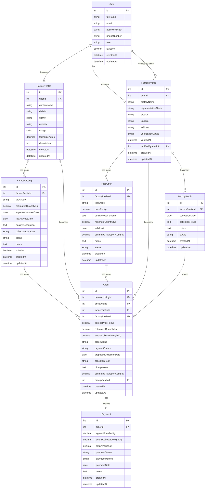

# ChaBondhu — Database Design

**Version:** 1.0  
**Date:** 2026-11-05  
**Database:** PostgreSQL  
**ORM:** TypeORM  
**Currency:** All monetary values are in Bangladeshi Taka (BDT)

---

## Table of Contents

1. [Design Principles](#1-design-principles)
2. [Entity: User](#2-entity-user)
3. [Entity: FarmerProfile](#3-entity-farmerprofile)
4. [Entity: FactoryProfile](#4-entity-factoryprofile)
5. [Entity: HarvestListing](#5-entity-harvestlisting)
6. [Entity: PriceOffer](#6-entity-priceoffer)
7. [Entity: Order](#7-entity-order)
8. [Entity: PickupBatch](#8-entity-pickupbatch)
9. [Entity: Payment](#9-entity-payment)
10. [Entity Relationship Summary](#10-entity-relationship-summary)
11. [ER Diagram](#11-er-diagram)
12. [Index Strategy](#12-index-strategy)
13. [Business Rule Enforcement Summary](#13-business-rule-enforcement-summary)

---

## 1. Design Principles

### 1.1 Core Rules

| Rule | Implementation |
|---|---|
| No floating-point for money | Use `NUMERIC(12, 2)` for all monetary and quantity columns |
| Agreed price is immutable | `agreedPricePerKg` is copied to `Order` at creation; never recalculated |
| Estimated quantity ≠ actual weight | `estimatedQuantityKg` on `HarvestListing`; `actualCollectedWeightKg` on `Order` |
| Order status ≠ payment status | Two independent enum columns on `Order`; managed by separate service methods |
| Soft delete preferred | `isActive` flag on `User` and `HarvestListing`; never hard-delete rows with order history |
| Referential integrity | All foreign keys enforced at the database level |
| Timestamps on all entities | Every table has `createdAt` and `updatedAt` columns |

### 1.2 Naming Conventions

- Table names: `snake_case` (auto-generated by TypeORM from entity class names)
- Column names: `camelCase` in TypeScript entities; TypeORM maps them to `snake_case` in PostgreSQL
- Primary keys: integer auto-increment (`SERIAL` / `BIGSERIAL`) — simple and sufficient for a university MVP
- Enum types: defined as TypeScript `enum`, stored as `varchar` in PostgreSQL

### 1.3 Decimal Precision

| Column Type | Precision | Use Case |
|---|---|---|
| `NUMERIC(12, 2)` | Up to 9,999,999,999.99 | Prices, costs, totals in BDT |
| `NUMERIC(10, 3)` | Up to 9,999,999.999 | Weights in kg (3 decimal places for accuracy) |
| `NUMERIC(8, 2)` | Up to 999,999.99 | Farm size in acres |

---

## 2. Entity: User

**Table name:** `user`  
**Purpose:** Stores all platform accounts — farmers, factory representatives, and admins.

### 2.1 Columns

| Column | TypeScript Type | PostgreSQL Type | Nullable | Default | Description |
|---|---|---|---|---|---|
| `id` | `number` | `SERIAL` PK | No | auto | Primary key |
| `fullName` | `string` | `VARCHAR(150)` | No | — | User's full name |
| `email` | `string` | `VARCHAR(255)` | No | — | Unique login identifier |
| `passwordHash` | `string` | `VARCHAR(255)` | No | — | bcrypt-hashed password; never plain text |
| `phoneNumber` | `string` | `VARCHAR(20)` | No | — | Contact number |
| `role` | `UserRole` | `VARCHAR(20)` | No | — | Enum: `GROWER`, `FACTORY`, `ADMIN` |
| `isActive` | `boolean` | `BOOLEAN` | No | `true` | Soft-delete / deactivation flag |
| `createdAt` | `Date` | `TIMESTAMPTZ` | No | `now()` | Auto-set on insert |
| `updatedAt` | `Date` | `TIMESTAMPTZ` | No | `now()` | Auto-set on update |

### 2.2 Enum: UserRole

```typescript
enum UserRole {
  GROWER  = 'GROWER',
  FACTORY = 'FACTORY',
  ADMIN   = 'ADMIN',
}
```

### 2.3 Constraints

| Constraint | Column | Rule |
|---|---|---|
| PRIMARY KEY | `id` | Unique, not null, auto-increment |
| UNIQUE | `email` | No two users share an email |
| NOT NULL | `fullName`, `email`, `passwordHash`, `phoneNumber`, `role` | Required fields |
| CHECK | `role` | Must be one of the enum values |

### 2.4 Relationships

| Relationship | With Entity | Cardinality | FK Location |
|---|---|---|---|
| Has one (optional) | `FarmerProfile` | 1 : 0..1 | `farmer_profile.userId` |
| Has one (optional) | `FactoryProfile` | 1 : 0..1 | `factory_profile.userId` |

### 2.5 Indexes

| Index | Column | Reason |
|---|---|---|
| PRIMARY | `id` | Auto-created |
| UNIQUE | `email` | Login lookup |
| INDEX | `role` | Filter users by role in admin views |
| INDEX | `isActive` | Filter out deactivated accounts efficiently |

### 2.6 Business Notes

- Email is immutable after registration.
- Password is never stored in plain text.
- Setting `isActive = false` effectively deactivates the account without deleting it.
- An `ADMIN` user does not have a `FarmerProfile` or `FactoryProfile`.

---

## 3. Entity: FarmerProfile

**Table name:** `farmer_profile`  
**Purpose:** Stores the farm/garden profile of a GROWER user. One farmer = one farm profile in MVP.

### 3.1 Columns

| Column | TypeScript Type | PostgreSQL Type | Nullable | Default | Description |
|---|---|---|---|---|---|
| `id` | `number` | `SERIAL` PK | No | auto | Primary key |
| `userId` | `number` | `INTEGER` FK | No | — | References `user.id`; unique |
| `gardenName` | `string` | `VARCHAR(200)` | No | — | Name of the tea garden / farm |
| `division` | `string` | `VARCHAR(100)` | No | — | Administrative division (e.g. Rangpur) |
| `district` | `string` | `VARCHAR(100)` | No | — | District (e.g. Panchagarh) |
| `upazila` | `string` | `VARCHAR(100)` | No | — | Sub-district / Thana |
| `village` | `string` | `VARCHAR(150)` | Yes | `NULL` | Optional village or area name |
| `farmSizeAcres` | `number` | `NUMERIC(8, 2)` | Yes | `NULL` | Farm size in acres (informational only) |
| `description` | `string` | `TEXT` | Yes | `NULL` | Optional free-text description |
| `createdAt` | `Date` | `TIMESTAMPTZ` | No | `now()` | — |
| `updatedAt` | `Date` | `TIMESTAMPTZ` | No | `now()` | — |

### 3.2 Constraints

| Constraint | Column | Rule |
|---|---|---|
| PRIMARY KEY | `id` | — |
| UNIQUE | `userId` | One farmer profile per user account |
| FOREIGN KEY | `userId` → `user.id` | Must reference a valid `User` |
| NOT NULL | `userId`, `gardenName`, `division`, `district`, `upazila` | Required fields |

### 3.3 Relationships

| Relationship | With Entity | Cardinality | FK Location |
|---|---|---|---|
| Belongs to | `User` | 1 : 1 | `farmer_profile.userId` |
| Has many | `HarvestListing` | 1 : N | `harvest_listing.farmerProfileId` |

### 3.4 Indexes

| Index | Column | Reason |
|---|---|---|
| PRIMARY | `id` | — |
| UNIQUE | `userId` | Enforce one-profile-per-user |
| INDEX | `district` | Location-based filtering in future enhancements |

### 3.5 Business Notes

- `farmSizeAcres` is stored for display only. It must never be used to automatically calculate harvest quantity.
- A farmer cannot have more than one `FarmerProfile` (enforced by UNIQUE on `userId`).

---

## 4. Entity: FactoryProfile

**Table name:** `factory_profile`  
**Purpose:** Stores the factory profile of a FACTORY user.

### 4.1 Columns

| Column | TypeScript Type | PostgreSQL Type | Nullable | Default | Description |
|---|---|---|---|---|---|
| `id` | `number` | `SERIAL` PK | No | auto | Primary key |
| `userId` | `number` | `INTEGER` FK | No | — | References `user.id`; unique |
| `factoryName` | `string` | `VARCHAR(200)` | No | — | Official factory name |
| `representativeName` | `string` | `VARCHAR(150)` | No | — | Contact person name |
| `district` | `string` | `VARCHAR(100)` | No | — | Factory district |
| `upazila` | `string` | `VARCHAR(100)` | No | — | Factory sub-district |
| `address` | `string` | `TEXT` | Yes | `NULL` | Optional full address |
| `verificationStatus` | `FactoryVerificationStatus` | `VARCHAR(20)` | No | `PENDING` | `PENDING`, `VERIFIED`, or `REJECTED` |
| `verifiedAt` | `Date` | `TIMESTAMPTZ` | Yes | `NULL` | Timestamp when verified |
| `verifiedByAdminId` | `number` | `INTEGER` FK | Yes | `NULL` | References `user.id` of verifying admin |
| `createdAt` | `Date` | `TIMESTAMPTZ` | No | `now()` | — |
| `updatedAt` | `Date` | `TIMESTAMPTZ` | No | `now()` | — |

### 4.2 Constraints

| Constraint | Column | Rule |
|---|---|---|
| PRIMARY KEY | `id` | — |
| UNIQUE | `userId` | One factory profile per user account |
| FOREIGN KEY | `userId` → `user.id` | Must reference a valid `User` |
| FOREIGN KEY | `verifiedByAdminId` → `user.id` | Must reference a valid `User` with ADMIN role |
| NOT NULL | `userId`, `factoryName`, `representativeName`, `district`, `upazila` | Required fields |

### 4.3 Relationships

| Relationship | With Entity | Cardinality | FK Location |
|---|---|---|---|
| Belongs to | `User` | 1 : 1 | `factory_profile.userId` |
| Has many | `PriceOffer` | 1 : N | `price_offer.factoryProfileId` |
| Verified by (optional) | `User` (Admin) | N : 1 | `factory_profile.verifiedByAdminId` |

### 4.4 Indexes

| Index | Column | Reason |
|---|---|---|
| PRIMARY | `id` | — |
| UNIQUE | `userId` | Enforce one-profile-per-user |
| INDEX | `isVerified` | Filter verified factories quickly |

### 4.5 Business Notes

- Only `VERIFIED` factories may publish offers. API responses derive `isVerified` from `verificationStatus` for compatibility.
- Approval sets `verifiedAt` and `verifiedByAdminId`. Each decision also adds a row to `factory_verification_reviews` in the same transaction.
- Each review links to the factory profile and reviewer and stores the decision, timestamp, and required rejection reason. A rejected factory can resubmit for another review with its previous decisions retained.

---

## 5. Entity: HarvestListing

**Table name:** `harvest_listing`  
**Purpose:** A farmer's listing of available tea leaves for sale.

### 5.1 Columns

| Column | TypeScript Type | PostgreSQL Type | Nullable | Default | Description |
|---|---|---|---|---|---|
| `id` | `number` | `SERIAL` PK | No | auto | Primary key |
| `farmerProfileId` | `number` | `INTEGER` FK | No | — | References `farmer_profile.id` |
| `teaGrade` | `string` | `VARCHAR(100)` | No | — | Free-text tea grade (e.g. "Green", "CTC") |
| `estimatedQuantityKg` | `number` | `NUMERIC(10, 3)` | No | — | Farmer's quantity estimate (not guaranteed) |
| `expectedHarvestDate` | `Date` | `DATE` | No | — | When the leaves will be ready |
| `lastHarvestDate` | `Date` | `DATE` | Yes | `NULL` | Optional previous harvest date |
| `qualityDescription` | `string` | `TEXT` | Yes | `NULL` | Free-text quality description |
| `collectionLocation` | `string` | `VARCHAR(255)` | No | — | Where leaves can be picked up |
| `status` | `ListingStatus` | `VARCHAR(20)` | No | `'ACTIVE'` | Enum: `ACTIVE`, `SOLD`, `EXPIRED`, `CANCELLED` |
| `notes` | `string` | `TEXT` | Yes | `NULL` | Optional additional information |
| `isActive` | `boolean` | `BOOLEAN` | No | `true` | Soft-delete flag for admin moderation |
| `createdAt` | `Date` | `TIMESTAMPTZ` | No | `now()` | — |
| `updatedAt` | `Date` | `TIMESTAMPTZ` | No | `now()` | — |

### 5.2 Enum: ListingStatus

```typescript
enum ListingStatus {
  ACTIVE    = 'ACTIVE',
  SOLD      = 'SOLD',
  EXPIRED   = 'EXPIRED',
  CANCELLED = 'CANCELLED',
}
```

### 5.3 Constraints

| Constraint | Column | Rule |
|---|---|---|
| PRIMARY KEY | `id` | — |
| FOREIGN KEY | `farmerProfileId` → `farmer_profile.id` | Must reference a valid farmer profile |
| NOT NULL | `farmerProfileId`, `teaGrade`, `estimatedQuantityKg`, `expectedHarvestDate`, `collectionLocation`, `status` | Required |
| CHECK | `estimatedQuantityKg > 0` | Quantity must be positive |
| CHECK | `status` | Must be a valid enum value |

### 5.4 Relationships

| Relationship | With Entity | Cardinality | FK Location |
|---|---|---|---|
| Belongs to | `FarmerProfile` | N : 1 | `harvest_listing.farmerProfileId` |
| Has many | `Order` | 1 : N | `order.harvestListingId` |

### 5.5 Indexes

| Index | Column | Reason |
|---|---|---|
| PRIMARY | `id` | — |
| INDEX | `farmerProfileId` | Load all listings for a farmer |
| INDEX | `status` | Filter active listings for marketplace view |
| INDEX | `teaGrade` | Filter by grade type |
| INDEX | `isActive` | Exclude soft-deleted listings |
| COMPOSITE | `(status, isActive)` | Main marketplace query: `WHERE status = 'ACTIVE' AND isActive = true` |

### 5.6 Business Notes

- `estimatedQuantityKg` is the farmer's declared estimate. It is NOT guaranteed.
- The actual collected weight is recorded as `actualCollectedWeightKg` on the `Order` entity — never on this listing.
- `isActive = false` means an admin has moderated/removed the listing. It is distinct from the `status` field.
- Status `SOLD` is set by the system when an order for this listing reaches `COMPLETED`.
- A farmer may only change status to `CANCELLED` if no order against this listing is in `ACCEPTED` or later state.

---

## 6. Entity: PriceOffer

**Table name:** `price_offers`  
**Purpose:** A factory's published buying price offer for a specific tea grade.

### 6.1 Columns

| Column | TypeScript Type | PostgreSQL Type | Nullable | Default | Description |
|---|---|---|---|---|---|
| `id` | `number` | `SERIAL` PK | No | auto | Primary key |
| `factoryProfileId` | `number` | `INTEGER` FK | No | — | References `factory_profile.id` |
| `teaGrade` | `string` | `VARCHAR(100)` | No | — | Tea grade this offer applies to |
| `pricePerKg` | `number` | `NUMERIC(12, 2)` | No | — | Buying price in BDT per kg |
| `qualityRequirements` | `string` | `TEXT` | Yes | `NULL` | Free-text quality criteria |
| `minimumQuantityKg` | `number` | `NUMERIC(10, 3)` | Yes | `NULL` | Optional minimum batch the factory will accept |
| `validUntil` | `string` | `DATE` | No | — | Offer expiry date as `YYYY-MM-DD` |
| `estimatedTransportCostBdt` | `number` | `NUMERIC(12, 2)` | Yes | `NULL` | Flat transport cost estimate (not per km in MVP) |
| `notes` | `string` | `TEXT` | Yes | `NULL` | Optional additional details |
| `status` | `OfferStatus` | `VARCHAR(20)` | No | `'ACTIVE'` | Enum: `ACTIVE`, `EXPIRED`, `WITHDRAWN` |
| `createdAt` | `Date` | `TIMESTAMPTZ` | No | `now()` | — |
| `updatedAt` | `Date` | `TIMESTAMPTZ` | No | `now()` | — |

### 6.2 Enum: OfferStatus

```typescript
enum OfferStatus {
  ACTIVE    = 'ACTIVE',
  EXPIRED   = 'EXPIRED',
  WITHDRAWN = 'WITHDRAWN',
}
```

### 6.3 Constraints

| Constraint | Column | Rule |
|---|---|---|
| PRIMARY KEY | `id` | — |
| FOREIGN KEY | `factoryProfileId` → `factory_profiles.id` | Links the offer to its owner. Publishing eligibility is enforced by the verification service. |
| NOT NULL | `factoryProfileId`, `teaGrade`, `pricePerKg`, `validUntil`, `status` | Required |
| CHECK | `pricePerKg > 0` | Price must be positive |
| CHECK | `minimumQuantityKg IS NULL OR minimumQuantityKg > 0` | If set, must be positive |
| CHECK | `estimatedTransportCostBdt IS NULL OR estimatedTransportCostBdt >= 0` | Cost cannot be negative |

### 6.4 Relationships

| Relationship | With Entity | Cardinality | FK Location |
|---|---|---|---|
| Belongs to | `FactoryProfile` | N : 1 | `price_offer.factoryProfileId` |
| Has many | `Order` | 1 : N | `order.priceOfferId` |

### 6.5 Indexes

| Index | Column | Reason |
|---|---|---|
| PRIMARY | `id` | — |
| INDEX | `factoryProfileId` | Load all offers for a factory |
| INDEX | `teaGrade` | Filter by tea grade |
| COMPOSITE | `(status, validUntil)` | Active offer query: `WHERE status = 'ACTIVE' AND validUntil >= today` |

### 6.6 Business Notes

- Only a `FactoryProfile` with `isVerified = true` may create a `PriceOffer`. Enforced in service layer.
- A price offer belongs to a factory and applies to a tea grade. The planned order holds the references to the offer and harvest listing.
- Updating a `PriceOffer` (price, quantity) must NOT affect any existing `Order` placed against it. The `agreedPricePerKg` on the order is the source of truth.
- `estimatedTransportCostBdt` is a flat estimate in BDT for MVP. Distance-based calculation is a future enhancement.
- Offers with `validUntil < today` should be treated as `EXPIRED` in queries. Status can also be updated by a background job or on-read check.

---

## 7. Entity: Order

**Table name:** `order`  
**Purpose:** A procurement order linking a farmer's harvest listing to a factory's price offer. Central entity of the platform.

### 7.1 Columns

| Column | TypeScript Type | PostgreSQL Type | Nullable | Default | Description |
|---|---|---|---|---|---|
| `id` | `number` | `SERIAL` PK | No | auto | Primary key |
| `harvestListingId` | `number` | `INTEGER` FK | No | — | References `harvest_listing.id` |
| `priceOfferId` | `number` | `INTEGER` FK | No | — | References `price_offer.id` |
| `farmerProfileId` | `number` | `INTEGER` FK | No | — | Denormalized reference to `farmer_profile.id` (for query convenience) |
| `factoryProfileId` | `number` | `INTEGER` FK | No | — | Denormalized reference to `factory_profile.id` (for query convenience) |
| `agreedPricePerKg` | `number` | `NUMERIC(12, 2)` | No | — | **Copied from `priceOffer.pricePerKg` at creation. IMMUTABLE.** |
| `estimatedQuantityKg` | `number` | `NUMERIC(10, 3)` | No | — | Copied from `harvestListing.estimatedQuantityKg` at creation |
| `actualCollectedWeightKg` | `number` | `NUMERIC(10, 3)` | Yes | `NULL` | Set by factory after physical collection |
| `orderStatus` | `OrderStatus` | `VARCHAR(30)` | No | `'REQUESTED'` | Current order status (see state machine) |
| `paymentStatus` | `PaymentStatus` | `VARCHAR(20)` | No | `'PENDING'` | Current payment status (independent of order status) |
| `proposedCollectionDate` | `Date` | `DATE` | Yes | `NULL` | Set when status moves to `PICKUP_SCHEDULED` |
| `collectionPoint` | `string` | `VARCHAR(255)` | Yes | `NULL` | Collection address set at scheduling |
| `pickupNotes` | `string` | `TEXT` | Yes | `NULL` | Optional logistics notes from factory |
| `estimatedTransportCostBdt` | `number` | `NUMERIC(12, 2)` | Yes | `NULL` | Transport cost for this specific order |
| `pickupBatchId` | `number` | `INTEGER` FK | Yes | `NULL` | Optional future link to `pickup_batch.id` |
| `createdAt` | `Date` | `TIMESTAMPTZ` | No | `now()` | — |
| `updatedAt` | `Date` | `TIMESTAMPTZ` | No | `now()` | — |

### 7.2 Enum: OrderStatus

```typescript
enum OrderStatus {
  REQUESTED        = 'REQUESTED',
  ACCEPTED         = 'ACCEPTED',
  REJECTED         = 'REJECTED',
  PICKUP_SCHEDULED = 'PICKUP_SCHEDULED',
  COLLECTED        = 'COLLECTED',
  COMPLETED        = 'COMPLETED',
  CANCELLED        = 'CANCELLED',
}
```

### 7.3 Enum: PaymentStatus

```typescript
enum PaymentStatus {
  PENDING    = 'PENDING',
  PROCESSING = 'PROCESSING',
  COMPLETED  = 'COMPLETED',
  FAILED     = 'FAILED',
}
```

### 7.4 Valid Order Status Transitions

| From | To | Triggered By | Condition |
|---|---|---|---|
| `REQUESTED` | `ACCEPTED` | Factory | Factory owns the price offer |
| `REQUESTED` | `REJECTED` | Factory | Factory owns the price offer |
| `ACCEPTED` | `PICKUP_SCHEDULED` | Factory | Pickup fields must be provided |
| `ACCEPTED` | `CANCELLED` | Farmer | Farmer owns the listing |
| `PICKUP_SCHEDULED` | `COLLECTED` | Factory | `actualCollectedWeightKg` must be provided |
| `COLLECTED` | `COMPLETED` | Factory | Payment record must exist |
| Any other combination | — | — | ❌ REJECTED (403 or 400) |

### 7.5 Valid Payment Status Transitions

| From | To | Triggered By |
|---|---|---|
| `PENDING` | `PROCESSING` | Factory |
| `PROCESSING` | `COMPLETED` | Factory |
| `PENDING` | `FAILED` | Factory |
| `PROCESSING` | `FAILED` | Factory |
| Any other combination | — | ❌ REJECTED |

### 7.6 Constraints

| Constraint | Column | Rule |
|---|---|---|
| PRIMARY KEY | `id` | — |
| FOREIGN KEY | `harvestListingId` → `harvest_listing.id` | Valid listing |
| FOREIGN KEY | `priceOfferId` → `price_offer.id` | Valid offer |
| FOREIGN KEY | `farmerProfileId` → `farmer_profile.id` | Valid farmer |
| FOREIGN KEY | `factoryProfileId` → `factory_profile.id` | Valid factory |
| FOREIGN KEY | `pickupBatchId` → `pickup_batch.id` | Optional; valid batch if set |
| NOT NULL | `harvestListingId`, `priceOfferId`, `farmerProfileId`, `factoryProfileId`, `agreedPricePerKg`, `estimatedQuantityKg`, `orderStatus`, `paymentStatus` | Required |
| CHECK | `agreedPricePerKg > 0` | Price must be positive |
| CHECK | `estimatedQuantityKg > 0` | Quantity must be positive |
| CHECK | `actualCollectedWeightKg IS NULL OR actualCollectedWeightKg >= 0` | Weight if set must be non-negative |

### 7.7 Relationships

| Relationship | With Entity | Cardinality | FK Location |
|---|---|---|---|
| Belongs to | `HarvestListing` | N : 1 | `order.harvestListingId` |
| Belongs to | `PriceOffer` | N : 1 | `order.priceOfferId` |
| Belongs to | `FarmerProfile` | N : 1 | `order.farmerProfileId` |
| Belongs to | `FactoryProfile` | N : 1 | `order.factoryProfileId` |
| Has one | `Payment` | 1 : 0..1 | `payment.orderId` |
| Belongs to (optional) | `PickupBatch` | N : 0..1 | `order.pickupBatchId` |

### 7.8 Indexes

| Index | Column | Reason |
|---|---|---|
| PRIMARY | `id` | — |
| INDEX | `farmerProfileId` | Load all orders for a farmer |
| INDEX | `factoryProfileId` | Load all orders for a factory |
| INDEX | `harvestListingId` | Check if a listing already has an active order |
| INDEX | `priceOfferId` | Load orders placed against a specific offer |
| INDEX | `orderStatus` | Filter by status in dashboard views |
| INDEX | `paymentStatus` | Filter by payment status |
| COMPOSITE | `(farmerProfileId, orderStatus)` | Farmer's active/completed order views |
| COMPOSITE | `(factoryProfileId, orderStatus)` | Factory's incoming/active order views |

### 7.9 Business Notes

- `agreedPricePerKg` is set once at order creation by copying `priceOffer.pricePerKg`. It must never be overwritten.
- `estimatedQuantityKg` is also copied from the listing at creation for historical reference.
- `actualCollectedWeightKg` is entered by the factory when moving the order to `COLLECTED`. It is the basis for payment.
- `orderStatus` and `paymentStatus` are independent fields. A factory may update payment status without changing order status.
- Denormalized `farmerProfileId` and `factoryProfileId` are included to avoid expensive joins in common queries (e.g., "show all orders for this factory").

---

## 8. Entity: PickupBatch

**Table name:** `pickup_batch`  
**Purpose:** Groups multiple orders into a single factory pickup trip. This entity is **future-ready** — it is designed now but its use is optional in the MVP. In the MVP, pickup details live directly on the `Order`. The `PickupBatch` entity exists so the schema can support grouped pickups in a future release without a breaking migration.

### 8.1 Columns

| Column | TypeScript Type | PostgreSQL Type | Nullable | Default | Description |
|---|---|---|---|---|---|
| `id` | `number` | `SERIAL` PK | No | auto | Primary key |
| `factoryProfileId` | `number` | `INTEGER` FK | No | — | References `factory_profile.id` |
| `scheduledDate` | `Date` | `DATE` | No | — | Planned collection date |
| `collectionRoute` | `string` | `TEXT` | Yes | `NULL` | Optional route description |
| `notes` | `string` | `TEXT` | Yes | `NULL` | Optional logistics notes |
| `status` | `BatchStatus` | `VARCHAR(20)` | No | `'PLANNED'` | Enum: `PLANNED`, `IN_PROGRESS`, `COMPLETED`, `CANCELLED` |
| `createdAt` | `Date` | `TIMESTAMPTZ` | No | `now()` | — |
| `updatedAt` | `Date` | `TIMESTAMPTZ` | No | `now()` | — |

### 8.2 Enum: BatchStatus

```typescript
enum BatchStatus {
  PLANNED     = 'PLANNED',
  IN_PROGRESS = 'IN_PROGRESS',
  COMPLETED   = 'COMPLETED',
  CANCELLED   = 'CANCELLED',
}
```

### 8.3 Relationships

| Relationship | With Entity | Cardinality | FK Location |
|---|---|---|---|
| Belongs to | `FactoryProfile` | N : 1 | `pickup_batch.factoryProfileId` |
| Has many | `Order` | 1 : N | `order.pickupBatchId` |

### 8.4 Indexes

| Index | Column | Reason |
|---|---|---|
| PRIMARY | `id` | — |
| INDEX | `factoryProfileId` | Load all batches for a factory |
| INDEX | `status` | Filter active batches |

### 8.5 MVP Note

> In the MVP, `Order.pickupBatchId` will remain `NULL`. All pickup coordination is done directly through the `Order` entity fields (`proposedCollectionDate`, `collectionPoint`, `pickupNotes`). `PickupBatch` is scaffolded for future use only and will not be used by any MVP service logic.

---

## 9. Entity: Payment

**Table name:** `payment`  
**Purpose:** Stores the final payment record for a completed or in-progress order. Created when the factory enters the actual collected weight.

### 9.1 Columns

| Column | TypeScript Type | PostgreSQL Type | Nullable | Default | Description |
|---|---|---|---|---|---|
| `id` | `number` | `SERIAL` PK | No | auto | Primary key |
| `orderId` | `number` | `INTEGER` FK | No | — | References `order.id`; unique (one payment per order) |
| `agreedPricePerKg` | `number` | `NUMERIC(12, 2)` | No | — | Copied from `order.agreedPricePerKg`; for display and audit |
| `actualCollectedWeightKg` | `number` | `NUMERIC(10, 3)` | No | — | Copied from `order.actualCollectedWeightKg` at payment record creation |
| `totalAmountBdt` | `number` | `NUMERIC(12, 2)` | No | — | Calculated: `agreedPricePerKg × actualCollectedWeightKg` |
| `paymentStatus` | `PaymentStatus` | `VARCHAR(20)` | No | `'PENDING'` | Mirrors `order.paymentStatus`; kept in sync |
| `paymentMethod` | `string` | `VARCHAR(100)` | Yes | `NULL` | Free-text e.g. "Bank Transfer", "Cash" |
| `paymentDate` | `Date` | `DATE` | Yes | `NULL` | Set when status becomes `COMPLETED` |
| `notes` | `string` | `TEXT` | Yes | `NULL` | Optional payment notes |
| `createdAt` | `Date` | `TIMESTAMPTZ` | No | `now()` | — |
| `updatedAt` | `Date` | `TIMESTAMPTZ` | No | `now()` | — |

### 9.2 Constraints

| Constraint | Column | Rule |
|---|---|---|
| PRIMARY KEY | `id` | — |
| UNIQUE | `orderId` | One payment record per order |
| FOREIGN KEY | `orderId` → `order.id` | Must reference a valid order |
| NOT NULL | `orderId`, `agreedPricePerKg`, `actualCollectedWeightKg`, `totalAmountBdt`, `paymentStatus` | Required |
| CHECK | `agreedPricePerKg > 0` | Price must be positive |
| CHECK | `actualCollectedWeightKg >= 0` | Weight must be non-negative |
| CHECK | `totalAmountBdt >= 0` | Total cannot be negative |

### 9.3 Relationships

| Relationship | With Entity | Cardinality | FK Location |
|---|---|---|---|
| Belongs to | `Order` | 1 : 1 | `payment.orderId` |

### 9.4 Indexes

| Index | Column | Reason |
|---|---|---|
| PRIMARY | `id` | — |
| UNIQUE | `orderId` | Enforce one-payment-per-order |
| INDEX | `paymentStatus` | Filter by payment status |

### 9.5 Business Notes

- A `Payment` record is created by the service when the factory confirms `actualCollectedWeightKg` (order moves to `COLLECTED`).
- `totalAmountBdt` is calculated at record creation: `agreedPricePerKg × actualCollectedWeightKg`. It uses fixed-precision arithmetic.
- `agreedPricePerKg` is redundantly stored here (also on `Order`) for auditability and to make payment receipts self-contained.
- No real money is transferred. This is a tracking record only.

---

## 10. Entity Relationship Summary

| Entity | Relates to | Type | Description |
|---|---|---|---|
| `User` → `FarmerProfile` | 1 : 0..1 | Has one (optional) | A GROWER user may have one farm profile |
| `User` → `FactoryProfile` | 1 : 0..1 | Has one (optional) | A FACTORY user may have one factory profile |
| `FarmerProfile` → `HarvestListing` | 1 : N | Has many | A farmer can have multiple listings |
| `FactoryProfile` → `PriceOffer` | 1 : N | Has many | A factory can have multiple offers |
| `HarvestListing` → `Order` | 1 : N | Has many | A listing can have multiple order requests (but only one accepted) |
| `PriceOffer` → `Order` | 1 : N | Has many | An offer can have orders from multiple farmers |
| `FarmerProfile` → `Order` | 1 : N | Has many | A farmer can have many orders (denormalized) |
| `FactoryProfile` → `Order` | 1 : N | Has many | A factory can have many orders (denormalized) |
| `Order` → `Payment` | 1 : 0..1 | Has one (optional) | An order has at most one payment record |
| `FactoryProfile` → `PickupBatch` | 1 : N | Has many | Future: a factory organizes pickup batches |
| `PickupBatch` → `Order` | 1 : N | Has many | Future: a batch contains multiple orders |

---

## 11. ER Diagram



---

## 12. Index Strategy

### Summary of All Indexes

| Table | Column(s) | Type | Purpose |
|---|---|---|---|
| `user` | `id` | PK | — |
| `user` | `email` | UNIQUE | Login lookup |
| `user` | `role` | INDEX | Admin: filter by role |
| `user` | `isActive` | INDEX | Exclude deactivated users |
| `farmer_profile` | `id` | PK | — |
| `farmer_profile` | `userId` | UNIQUE | One profile per user |
| `farmer_profile` | `district` | INDEX | Location filtering |
| `factory_profile` | `id` | PK | — |
| `factory_profile` | `userId` | UNIQUE | One profile per user |
| `factory_profile` | `verificationStatus` | INDEX | Filter factories by verification status |
| `harvest_listing` | `id` | PK | — |
| `harvest_listing` | `farmerProfileId` | INDEX | Farmer's listings |
| `harvest_listing` | `status, isActive` | COMPOSITE | Marketplace query |
| `harvest_listing` | `teaGrade` | INDEX | Filter by grade |
| `price_offer` | `id` | PK | — |
| `price_offer` | `factoryProfileId` | INDEX | Factory's offers |
| `price_offer` | `status, validUntil` | COMPOSITE | Active offer query |
| `price_offer` | `teaGrade` | INDEX | Filter by grade |
| `order` | `id` | PK | — |
| `order` | `farmerProfileId, orderStatus` | COMPOSITE | Farmer's order dashboard |
| `order` | `factoryProfileId, orderStatus` | COMPOSITE | Factory's order dashboard |
| `order` | `harvestListingId` | INDEX | Check listing's orders |
| `order` | `priceOfferId` | INDEX | Orders for an offer |
| `payment` | `id` | PK | — |
| `payment` | `orderId` | UNIQUE | One payment per order |
| `payment` | `paymentStatus` | INDEX | Filter by payment status |
| `pickup_batch` | `id` | PK | — |
| `pickup_batch` | `factoryProfileId` | INDEX | Factory's batches |

---

## 13. Business Rule Enforcement Summary

| Rule | Enforced In | Mechanism |
|---|---|---|
| Agreed price is immutable | Service layer | `agreedPricePerKg` is set once at order creation; no update path exists for it |
| Only verified factory can create offers | Service layer | Check `factoryProfile.isVerified` before creating a `PriceOffer` |
| Only the farmer who owns the listing can create/cancel it | Service layer | Compare `harvestListing.farmerProfileId` with `req.user.farmerProfileId` |
| Only the factory who owns the offer can accept/reject orders | Service layer | Compare `order.factoryProfileId` with `req.user.factoryProfileId` |
| Valid order status transitions only | Service layer | Transition table checked in `OrdersService.updateStatus()` |
| Valid payment status transitions only | Service layer | Transition table checked in `OrdersService.updatePaymentStatus()` |
| One farmer profile per user | Database | UNIQUE constraint on `farmer_profile.userId` |
| One factory profile per user | Database | UNIQUE constraint on `factory_profile.userId` |
| One payment record per order | Database | UNIQUE constraint on `payment.orderId` |
| Decimal arithmetic for financial values | Database + TypeScript | `NUMERIC(12,2)` column type; JS `toFixed(2)` or string-based calculation |
| Farm size is not a yield predictor | Service layer | No code path derives quantity from farm size |
| Soft delete preserves history | Database | `isActive = false` on User and HarvestListing; foreign keys preserved |

---

*Document version: 1.0*  
*Created: 2026-11-05*  
*Update this document when any entity schema changes.*
