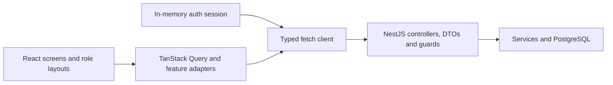

# ChaBondhu frontend architecture plan

Planning baseline: backend main at `02781a61a43512378adc10d20ccbb4aab9e43d3b`. UI routes and technology choices below are proposals. HTTP contracts were checked against the NestJS controllers, DTOs, guards and services, with the entities and migrations used to verify relationships. The [README](../README.md), [API design](api-design.md), [architecture](architecture.md), [database design](database-design.md) and [project requirements](project-requirements.md) provide the domain context. Where these disagree, use the running contract. Swagger JSON is served at `/api-json` and the interactive UI at `/api`.

## Stack and deployment model

| Decision | Recommendation and trade-off |
|---|---|
| App | React + Vite + strict TypeScript. The marketplace data and dashboards require sign-in, so a static SPA consumes NestJS directly without a second application server. Lazy-load role or feature routes as the project grows. Static hosting requires a history fallback for deep links. [Vite static deployment](https://vite.dev/guide/static-deploy) |
| Alternative | Next.js offers file-based routing, static export and a path to server rendering. Revisit it if anonymous, indexable marketplace pages or a server-side session layer become requirements. Server-dependent features require a runtime beyond a static export. [Next.js static exports](https://nextjs.org/docs/app/guides/static-exports) |
| Routing | React Router with public, signed-in marketplace and role-specific layouts. Use URL search parameters for supported filters and pagination to make views shareable. |
| Styling | Tailwind CSS with CSS custom properties for identity tokens and a small set of native controls. Add selected Radix primitives for dialog and menu interactions. A shadcn/ui subset is reasonable if the team wants editable component source. MUI is an alternative if ready-made tables and a broad catalog outweigh the work of adapting its visual language. |
| Data | One typed fetch client and TanStack Query for remote state, cache invalidation and mutation lifecycle. Use local state for transient UI and context for the session. Axios is optional if the team needs its API. Redux is unnecessary for the present cross-screen state. |
| Forms | React Hook Form and Zod for client feedback and action-specific schemas. Mirror DTO rules and send only accepted fields. NestJS remains authoritative. Keep date-only values as strings and payment totals as exact decimal strings. |

## App boundaries



Proposed location is a new `frontend/` package in the same repository, with its own scripts and public environment template. Keep the current backend package, migrations and deployment independent.

```text
frontend/src/
  app/                 router, providers, layout shells, route guards
  features/
    auth/              login, registration, session
    profiles/          grower and factory forms, verification history
    marketplace/       listings and offers, filters and owner editing
    procurement/      requests, orders, pickup and collection
    payments/         amount, submission, decisions, history
    admin/            verification lookup and payment oversight
  shared/
    api/              fetch transport, HTTP errors, pagination adapters
    ui/               inputs, dialogs, status chips, skeletons
    format/           BDT, kg and Bangladesh date display
```

Use a public `VITE_API_BASE_URL` with no private configuration. For local development choose a development proxy or configure the backend's `CORS_ORIGINS` for the exact frontend origin. Direct cross-origin requests must allow the bearer and idempotency headers. Production hosting can serve both through a same-origin reverse proxy or use separate HTTPS origins with explicit CORS. Never place backend secrets in Vite variables. [Vite environment variables](https://vite.dev/guide/env-and-mode.html)

### Session and errors

- Log in via `POST /auth/login`, which returns `{ accessToken, user }`. Use the returned role and verify the authenticated identity with `GET /users/me`. The JWT strategy validates expiry and loads the active account. Backend ownership checks decide each action.
- Hold the MVP bearer token in memory, send it in `Authorization: Bearer …`, and explain that reload requires sign-in. Logout clears the session and private query cache. Avoid persistent bearer storage by default. A persistent, revocable session needs additional backend work.
- Public routes are `/`, `/login`, and `/register`. Proposed UI paths `/marketplace/listings` and `/marketplace/offers` require authentication. Group dashboard routes under `/grower`, `/factory` and `/admin`; use nested detail routes with numeric IDs. Role gates improve navigation; they confer no authorization. Preserve only safe internal return paths.
- Normalize HTTP responses into status, message and optional metadata. Handle `400` with field hints plus the server message, protected-request `401` by clearing the session, `403` as forbidden, `404` as missing or inaccessible, and `409` as a state conflict with refetch. Use safe retry for reads and explicit retry for mutations. Keep payment keys stable across network retries of the same payload.
- Scope private caches by account and clear them on account changes. Invalidate affected listing, request, order and payment queries after mutations. Confirm server state before updating financial or lifecycle actions.

## Screens and HTTP mapping

“Signed-in” includes any authenticated role unless specified. Paths below are backend paths. Use account IDs for admin verification, and order IDs in all payment paths.

| Screen | Actor | API | Required data and expected contract | Availability |
|---|---|---|---|---|
| Landing | Visitor | None | Explain grower and factory journeys, with sign-in and registration links | Static |
| Anonymous listing and offer browsing | Visitor | No anonymous routes | Both marketplace browse and detail controllers require JWT. Show a sign-in prompt. | Missing for guests |
| Sign in and register | Visitor | `POST /auth/login`, `POST /auth/register` | Login accepts email and password. Registration accepts fullName, email, password, phoneNumber and role (`GROWER` or `FACTORY`). Sign in after registration. | Available |
| Account and grower profile | Grower | `GET/PATCH /users/me`, `GET/PATCH /farmer-profiles/me`, `POST /farmer-profiles` | Grower form requires gardenName, division, district and upazila. Optional village, farmSizeAcres, description. Profile absence leads to onboarding. | Available |
| Factory profile and verification | Factory | `GET/PATCH /factory-profiles/me`, `POST /factory-profiles`, `GET /factory-profiles/me/verification-history`, `PATCH /factory-profiles/me/resubmit-verification` | factoryName, representativeName, district, upazila, optional address. Display PENDING, VERIFIED or REJECTED; resubmit after rejection. | Available |
| Marketplace listings | Signed-in | `GET /listings`, `GET /listings/:id` | teaGrade, district, page and limit. List returns data, total, page and limit. Show listing grade, quantity, date and collection location where returned. | Available |
| Marketplace offers | Signed-in | `GET /offers`, `GET /offers/:id` | teaGrade, minPrice, maxPrice, page, limit, sortBy and sortOrder. Sort by pricePerKg, validUntil, minimumQuantityKg or createdAt, ASC/DESC. | Available |
| My harvest listings | Grower | `GET /listings/my`, `POST /listings`, `PATCH /listings/:id`, `PATCH /listings/:id/cancel` | Own list returns an array. Create with teaGrade, estimatedQuantityKg, expectedHarvestDate and collectionLocation; optional lastHarvestDate, qualityDescription and notes. Only eligible owner listings can change. | Available |
| My offers | Factory | `GET /offers/my`, `POST /offers`, `PATCH /offers/:id`, `PATCH /offers/:id/withdraw` | Filter own list by status. Publish with teaGrade, pricePerKg, validUntil and optional qualityRequirements, minimumQuantityKg, estimatedTransportCostBdt, notes. Edit only pricePerKg, minimumQuantityKg, validUntil and notes. Show verification eligibility before offering mutations. | Available |
| Request procurement | Verified factory | `POST /order-requests` | Send harvestListingId and priceOfferId. Select a matching eligible own offer. Show the quoted price as a snapshot. | Available |
| My requests | Factory | `GET /order-requests/my`, `PATCH /order-requests/:id/withdraw` | Paginated requests with optional status filter. Withdraw an owned pending request. | Available |
| Listing inbox | Owning grower | `GET /listings/:id/order-requests`, `PATCH /order-requests/:id/accept`, `PATCH /order-requests/:id/reject` | Per-listing paginated inbox. Acceptance returns `{ request, order }` and closes competing requests. | Available; no global grower inbox |
| Orders and detail | Grower, factory; admin detail | `GET /orders/my`, `GET /orders/:id` | Participant list filters orderStatus/paymentStatus. Detail includes immutable price and estimate, actual weight, pickup fields and participant summaries. | Available |
| Cancel before pickup | Owning grower | `PATCH /orders/:id/status` | Send `{ orderStatus: "CANCELLED" }` while accepted. | Available |
| Pickup and collection | Owning factory; grower views | `PATCH /orders/:id/status`, `GET /orders/:id` | PICKUP_SCHEDULED requires proposedCollectionDate and collectionPoint; optional pickupNotes and estimatedTransportCostBdt. COLLECTED requires positive actualCollectedWeightKg to three decimal places. | Available; grower writes unavailable |
| Amount and submission | Owning factory submits; participants/admin read | `GET /payments/order/:orderId/amount`, `POST /payments/order/:orderId/attempts` | Amount returns amountBdt as an exact string. Submit method, paymentDate and conditional provider/reference, with Idempotency-Key header. Response is paymentId, orderId, amountBdt, currency and attempt. | Available |
| Receipt decision | Owning grower | `PATCH /payments/order/:orderId/attempts/:attemptId/confirm` and `…/reject` | Confirm with an empty body object. Reject with rejectionReason. Response is the resulting attempt with decision metadata. | Available |
| Settlement and history | Participants or admin; own list for participants | `GET /payments/order/:orderId`, `GET /payments/order/:orderId/history`, `GET /payments/my` | Settlement has id, orderId, amountBdt, currency, paymentStatus and createdAt. History includes decision, rejectionReason, timestamps and attempt IDs. | Available |
| Complete order | Owning factory | `PATCH /orders/:id/status` | Send `{ orderStatus: "COMPLETED" }` after collection and confirmed payment. Listing changes to SOLD in the same transaction. | Available |
| Verification lookup | Admin | `GET /admin/users/:id/factory-verification`, `PATCH /admin/users/:id/verify`, `PATCH /admin/users/:id/reject-verification` | Known factory user ID, profile and history. Reject with reason. Pending state required. | Available by ID; no queue |
| Payment oversight | Admin | `GET /admin/payments`, payment detail/history endpoints above | Paginated settlements with drill-down by orderId. Read-only. | Available |
| Listing moderation | Admin | `DELETE /listings/:id` | Existing action by known listing ID; confirmation dialog required. | Available by ID |
| User directory and platform monitoring | Admin | No matching controllers | User directory, activation/deactivation, all-status listing directory, all-order directory and monitoring metrics are deferred. | Missing |

### Workflow and integration details

- Use role-specific status and actions. Listing reservation belongs to an accepted request. An order can reopen the listing through eligible pre-pickup cancellation. A completed order marks the listing sold. Present order and payment status separately.
- A factory records pickup and actual collection weight. The grower sees those details and decides payment receipt. No grower pickup-edit or collection-recording controls.
- Payment states are PENDING → SUBMITTED → CONFIRMED or REJECTED → resubmission. Confirmation leaves the order collected. Display a separate factory completion action. Preserve prior rejected attempts.
- CASH accepts an optional reference and no provider. BANK_TRANSFER requires provider and reference. MOBILE_FINANCIAL_SERVICE requires BKASH or NAGAD and a reference. Payment dates are date-only. Generate a fresh submission key for a genuinely new attempt and a new external reference after rejection. Same-key replay returns the original submission response with HTTP 201, so refetch current settlement state. Keep identifiers and evidence private.
- Differentiate empty state from a cloaked `404`. A settlement can be absent before the first submission. Non-payable or uncollected orders may produce `409` from the amount endpoint. Never compute a payable fallback from estimated weight or send an amount in a submission.
- Keep `YYYY-MM-DD` dates as civil dates. Offer expiry follows Bangladesh time. Display timestamps in Asia/Dhaka. Preserve server precision for BDT and use locale-aware display without recalculating the payable amount.
- Use per-feature contracts rather than one assumed pagination envelope. Orders, requests, offers and payment lists use data/total/page/limit/totalPages. Listing browse omits totalPages, and own listings return an array. Review generated Swagger schemas against service serialization before any automated client generation.

## Visual design and accessibility

| Element | Direction |
|---|---|
| Identity | Tea-leaf green `#215442`, ink `#182821`, warm cream `#F7F4E9`, white surfaces and amber `#A45D12` for accents. Reserve red for problems and use words and icons alongside color. Test contrast on actual combinations. |
| Typography | Instrument Sans for UI, Noto Sans Bengali for Bangla text, and an optional serif accent on landing headings. Use readable numeric columns for BDT and weight. |
| Public experience | Compact header with brand, sign-in and registration. Use one relevant local tea-growing photo with usage rights and accessible text, then brief grower and factory paths. |
| Dashboard | Desktop navigation rail and focused page content. Mobile uses a compact header, a manageable set of primary tabs or menu items, stacked summaries and a clearly labeled next action. Avoid KPI placeholders when aggregates are unavailable. |
| Components | Listing and offer cards, filter sheet, two independent status chips, pickup detail panel, payment attempt timeline, paginated results, form fields and confirmation dialog. Responsive tables can use summary cards on narrow screens. |
| States | Skeletons for first load, inline progress for mutations, actionable empty states, server error summaries and explicit retry. Focus the first invalid field, announce results, restore dialog focus and support keyboard access. |
| Accessibility | Test 320px layouts, zoom, keyboard-only task completion, contrast and accessible names. Use text for state labels and confirmation summaries with order ID and amount where relevant. |

Suggested navigation: Grower **Listings · Orders · Payments · Profile**; Factory **Marketplace · Offers · Requests · Orders · Payments · Profile**; Admin **Factory verification · Payments**. Dashboard entry points can show actionable recent records from the caller's existing lists instead of platform-wide counts.

## Backend gaps and release decisions

| Gap | Impact and MVP treatment |
|---|---|
| Anonymous listing and offer reads | No blocker for the authenticated MVP. A public catalog requires an explicit product and data-visibility decision and backend endpoints. |
| Admin discovery and operations | Several admin routes appear in the API design but have no matching controller. Use verification lookup by known user ID and existing payment oversight. A usable discovery queue, user directory and monitoring require new contracts. |
| Unified grower inbox and notification feeds | Per-listing requests are available. Navigate from My Listings. Defer a combined queue, badges requiring aggregate counts and real-time notifications. |
| Session lifecycle | No refresh, logout/revocation, or password-reset API was found. In-memory session and local logout cover the demo. Decide on a persistent-session design before requiring seamless reloads or server-side revocation. |
| Pickup negotiation and batching | Factory scheduling and collection per order are implemented. Defer grower scheduling/collection writes, grouped pickup, and mapping. |
| Payment evidence and gateways | Current flow records external settlements and receipt decisions. Defer uploads, online payments, and partial settlements. |
| Contract and launch validation | Before frontend wiring, confirm browser CORS/preflight, pin the Swagger/API baseline, and capture real empty/error samples. Before external launch, require a securely configured backend JWT signing secret and address the development fallback in a separate backend change. |

## Implementation roadmap

Start implementation only after plan review. Use a frontend feature branch. Each row is a small reviewable checkpoint with its own commit, tests and push to that branch. Use an isolated or explicitly approved demo database for write journeys.

| Milestone | Modules and objective | Verification before commit and push |
|---|---|---|
| 1. Shell and transport | app, shared; routing, identity tokens, API/error adapters and dev configuration | Typecheck/build; router deep links, API errors, responsive shells and CORS preflight |
| 2. Auth and onboarding | auth, profiles; signed-in session, role routing, create/update profiles and factory state | Session expiry and cache clearing, forbidden routes, reload behavior, real login and onboarding |
| 3. Marketplace | marketplace; authenticated browse, filters, detail and owner CRUD already supported | DTO and filter unit checks, empty pages, pagination, ownership and verification-denied actions |
| 4. Requests and order journey | procurement; request creation/withdrawal, grower inbox, decisions, cancellation, pickup and collection | Role checks, competing request conflict, immutable price/estimate, independent actual weight and mobile journey |
| 5. Payments and completion | payments + procurement; exact amount, attempt history, rejection/resubmission and factory completion | Same-key retry, altered payload conflict, role denial, confirmed payment with collected order, final SOLD; run browser journey against isolated NestJS |
| 6. Admin and release review | admin + shared; known-ID verification, payment oversight and accessible UI polish | Read-only admin payment tests, denied non-admin routes, keyboard and mobile review, end-to-end demo and production build |

Use Vitest and React Testing Library for UI and state behavior, MSW for deterministic HTTP cases, and Playwright for role-based journeys. Mock fixtures must reflect verified response shapes. Exercise the critical grower-to-factory workflow against the actual NestJS API as a separate check.

## Planning exit criteria

Approve the stack, in-memory session trade-off, authenticated marketplace and admin known-ID scope. Approve any expanded backend work separately. This checkpoint changes documentation only.
